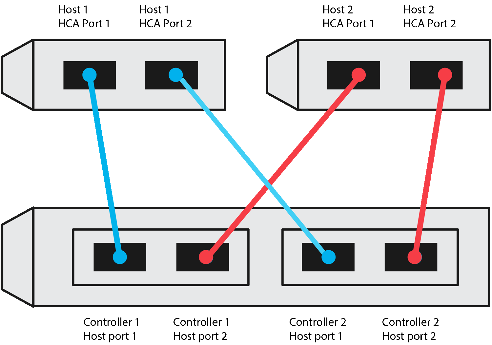
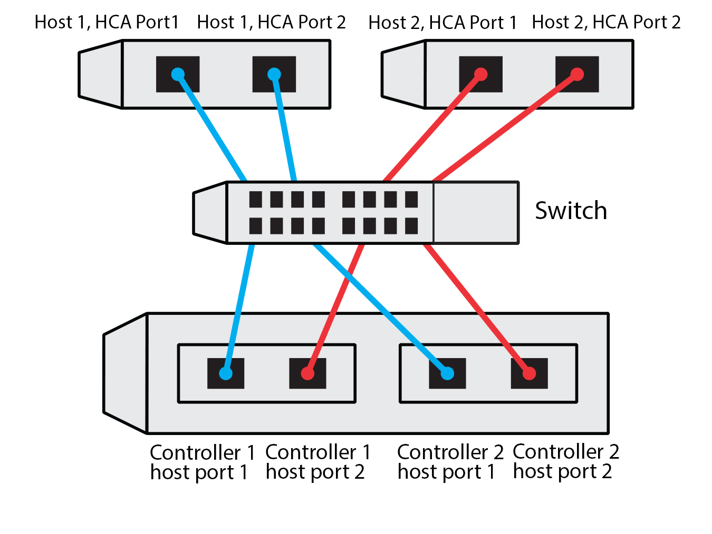

= EシリーズLinuxホスト向けNVMe over TCP構成ワークシート
:allow-uri-read: 
:icons: font
:imagesdir: ../media/

[role="lead"]
このページをPDFファイルとして生成して印刷し、その後、次のワークシートを使用してNVMe over TCPストレージの構成情報を記録できます。プロビジョニング作業を実行するには、この情報が必要です。

[[direct-connect-topology]]
== 直接接続トポロジ

直接接続トポロジーでは、1つまたは複数のホストがサブシステムに直接接続されます。SANtricity OS 11.50リリースでは、以下に示すように、各ホストからサブシステムコントローラへの単一の接続をサポートしています。この構成では、各ホストの1つのNIC（ネットワーク インターフェイス カード）ポートは、接続先のEシリーズコントローラーポートと同じサブネット上にある必要がありますが、もう一方のNICポートとは異なるサブネット上にある必要があります。

この要件を満たす例として、次の 4 つのネットワークサブネットがあります。

* サブネット 1: ホスト 1 NIC ポート 1 およびコントローラ 1 ホスト ポート 1
* サブネット2：ホスト1のNICポート2とコントローラ2のホストポート1
* サブネット3：ホスト2のNICポート1とコントローラ1のホストポート2
* サブネット4：ホスト2のNICポート2とコントローラ2のホストポート2

[[switch-connect-topology]]
== スイッチ接続トポロジ

ファブリックトポロジでは、 1 つ以上のスイッチを使用します。を参照してください https://mysupport.netapp.com/matrix["NetApp Interoperability Matrix Tool で確認できます"^] を参照してください。

[[host-identifiers]]
== ホスト識別子

各ホストのイニシエータ NQN を特定して記録します。

|===
| ホストポート接続 | ソフトウェアイニシエータの NQN 

 a| 
ホスト（イニシエータ） 1.
 a| 
{nbsp}

 a| 
{nbsp}
 a| 
{nbsp}

 a| 
ホスト（イニシエータ） 2.
 a| 
{nbsp}

 a| 
{nbsp}
 a| 
{nbsp}

 a| 
{nbsp}
 a| 
{nbsp}

|===

[[target-nqn]]
== ターゲット NQN

ストレージアレイのターゲット NQN を記録します。

|===
| アレイ名 | ターゲット NQN 

 a| 
アレイコントローラ（ターゲット）
 a| 

|===

[[target-nqns]]
== ターゲット NQN

アレイポートで使用する NQN を記録します。

|===
| アレイコントローラ（ターゲット）ポート接続 | NQN 

 a| 
コントローラ A のポート 1
 a| 

 a| 
コントローラ B のポート 1
 a| 

 a| 
コントローラ A のポート 2
 a| 

 a| 
コントローラ B 、ポート 2
 a| 

|===

[[mapping-host-name]]
== マッピングホスト名

NOTE: マッピングホスト名はワークフロー中に作成されます。

|===

 a| 
マッピングホスト名
 a| 

 a| 
ホスト OS タイプ
 a| 

|===