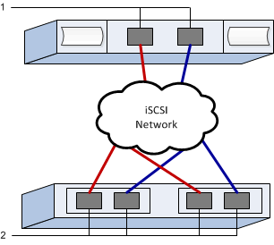

= EシリーズのVMware向けiSCSIスイッチとネットワークの設定
:allow-uri-read: 
:experimental: 
:icons: font
:imagesdir: ../media/

[role="lead"]
iSCSI プロトコルを使用する場合は、スイッチを設定し、アレイ側とホスト側でネットワークを設定します。その後、 IP ネットワーク接続を確認します。

NOTE: VMwareとの互換性を確保するため、4096バイトのドライブを使用する場合は、ボリュームを512バイトエミュレーション（512e）を使用するように設定する必要があります。ボリュームを512バイトエミュレーション（512e）を使用するように設定する方法の詳細については、SANtricity System Managerのオンラインヘルプを参照してください。

[[step-1-record-your-configuration]]
== ステップ1：設定を記録する

このページをPDFファイルとして生成して印刷し、その後、次のワークシートを使用して、プロトコル固有のストレージ構成情報を記録することができます。プロビジョニング作業を行う際に、この情報が必要になります。

図は、VLANおよび/または固有のサブネットによって分離されたEシリーズ ストレージ アレイに接続されているホストを示しています。一方のVLAN/サブネットは青線で示され、もう一方のVLAN/サブネットは赤線で示されています。各VLAN/サブネットには、少なくとも1つのイニシエータポートと、ターゲットポートの半数が含まれます。ホストポートおよび/またはコントローラポートの数は、ネットワークインターフェースの数とコントローラのモデルによって異なります。コントローラーあたり最大6個のポートが利用できる場合があります。

[[host-mapping-information]]
=== ホストマッピング情報

[cols="35h,~"]
|===
| マッピングホスト名 |  

| ホスト OS タイプ |  

| ホスト IQN |  

| ターゲット IQN |  
|===

[[step-2-configure-the-switches]]
== ステップ2：スイッチの設定

iSCSI に関するベンダーの推奨事項に従ってスイッチを設定します。これらの推奨事項には、設定の指示とコードの更新が含まれる場合があります。

.作業を開始する前に
次のものがあることを確認します。

* 高可用性を実現するために、 2 つの独立したネットワークiSCSI トラフィックを別々のネットワークセグメントに分離してください。
* 送受信ハードウェアフロー制御（*エンドツーエンド*）を有効にしました。
* 優先度フロー制御が無効になりました。
* 必要に応じて、ジャンボフレームを有効にしてください（推奨）。

NOTE: コントローラのスイッチポートでは、ポートチャネル / LACP がサポートされません。ホスト側 LACP は推奨されません。マルチパスを使用すると、同等以上のメリットが得られます。

.手順
スイッチベンダーのマニュアルを参照してください。

[[step-3-configure-networking]]
== ステップ3：ネットワークの設定

iSCSI ネットワークは、データストレージの要件に応じて、さまざまな方法でセットアップできます。環境に最適な構成を選択するには、ネットワーク管理者に相談してください。

.作業を開始する前に
次のものがあることを確認します。

* 送受信ハードウェアフロー制御（*エンドツーエンド*）を有効にしました。
* 優先度フロー制御が無効になりました。
* 必要に応じて、ジャンボフレームを有効にしてください（推奨）。
+
パフォーマンス上の理由から IP SAN 内でジャンボフレームを使用している場合は、アレイ、スイッチ、およびホストをジャンボフレームを使用するように構成してください。ホストおよびスイッチでジャンボフレームを有効にする方法については、オペレーティングシステムおよびスイッチのマニュアルを参照してください。アレイでジャンボフレームを有効にするには、手順 4 の手順を完了してください。

.このタスクについて
iSCSI ネットワークを計画する際には、 https://configmax.broadcom.com/guest["VMware Configuration Maximums Guide"^]に、LUN への最大サポート iSCSI パス数は 32 であり、サーバーごとにソフトウェア iSCSI スタックに関連付けたりポートバインドしたりできる NIC の最大数は 8 であると規定されています。パスの設定数が多くなりすぎないように、この要件を考慮する必要があります。

iSCSI ポートバインドを使用していない場合、 VMware iSCSI ソフトウェアイニシエータによって iSCSI ターゲットごとに 1 つのセッションがデフォルトで作成されます。

NOTE: VMware iSCSIポートバインディングは、バインドされたすべてのVMkernelポートを、構成されたネットワークセグメント上でアクセス可能なすべてのターゲットポートに強制的にログインさせる機能です。これは、iSCSIターゲットに単一のネットワークアドレスを提供するアレイで使用することを想定しています。NetAppでは、iSCSIポートバインディングを使用しないことを推奨します。詳細については、 https://techdocs.broadcom.com/us/en/vmware-cis/vsphere/vsphere/9-1/vsphere-storage/configuring-iscsi-and-iser-adapters-and-storage-with-esxi/setting-up-network-for-iscsi-and-iser-with-esxi/best-practices-for-configuring-networking-with-software-iscsi.html["ESX/ESXiでソフトウェアiSCSIポートバインディングを使用するためのベストプラクティス"^]を参照してください。ESXiホストが別のベンダーのストレージに接続されている場合、NetAppでは、ポートバインディングとの競合を避けるため、iSCSI vmkernelポートを別々に使用することをお勧めします。

適切なマルチパス構成を実現するために、 iSCSI ネットワークに複数のネットワークセグメントを使用します。ホスト側のポートと各アレイコントローラのポートを少なくとも 1 つずつ 1 つのネットワークセグメントに配置し、同じグループのホスト側とアレイ側のポートをもう 1 つのネットワークセグメントに配置します。可能であれば、複数のイーサネットスイッチを使用してさらに冗長性を確保します。

.手順
スイッチベンダーのマニュアルを参照してください。

NOTE: 多くのネットワークスイッチは 9 、 000 バイトを超える IP オーバーヘッドを設定する必要があります。詳細については、スイッチのマニュアルを参照してください。

[[step-4-configure-array-side-networking]]
== ステップ4：アレイ側のネットワークを設定する

SANtricity System Manager の GUI を使用して、アレイ側の iSCSI ネットワークを設定します。

.作業を開始する前に
次のものがあることを確認します。

* いずれかのストレージアレイコントローラの IP アドレスまたはドメイン名。
* System Manager GUI 、ロールベースアクセス制御（ RBAC ）、または LDAP のパスワード、およびディレクトリサービスを設定して、ストレージアレイへの適切なセキュリティアクセスを可能にします。アクセス管理の詳細については、 SANtricity システムマネージャオンラインヘルプを参照してください。

.このタスクについて
このタスクでは、ハードウェアページから iSCSI ポート設定にアクセスする方法について説明します。設定には、 System （設定） > Configure iSCSI Ports （ iSCSI ポートの設定）メニューからもアクセスできます。

NOTE: VMware構成におけるアレイ側ネットワークの設定方法に関する詳細については、以下のテクニカルレポートを参照してください： https://www.netapp.com/pdf.html?item=/media/17017-tr4789.pdf["『 VMware Configuration Guide for E Series SANtricity iSCSI Integration with ESXi 6.x and 7.x 』"^]。

.手順
. ブラウザで、「 + https://<DomainNameOrIPAddress>+` 」という URL を入力します
+
「 IPAddress 」は、ストレージアレイコントローラの 1 つのアドレスです。

+
設定されていないアレイで初めて SANtricity システムマネージャを開くと、管理者パスワードの設定プロンプトが表示されます。ロールベースアクセス管理では、 admin 、 support 、 security 、 monitor の 4 つのローカルロールが設定されます。最後の 3 つのロールには、推測されにくいランダムなパスワードが設定されています。admin ロールのパスワードを設定したら、 admin クレデンシャルを使用してすべてのパスワードを変更できます。4 つのローカルユーザロールの詳細については、 SANtricity System Manager オンラインヘルプを参照してください。

. 管理者パスワードの設定フィールドとパスワードの確認フィールドに管理者ロールの System Manager パスワードを入力し、 * パスワードの設定 * をクリックします。
+
プール、ボリューム グループ、ワークロード、または通知が設定されていない場合、セットアップ ウィザードが起動します。

. セットアップウィザードを閉じます。
+
このウィザードは、あとで追加のセットアップタスクを実行する際に使用します。

. 「 * ハードウェア * 」を選択します。
. 図にドライブが表示されている場合は、 * シェルフの背面を表示 * をクリックします。
+
図の表示が切り替わり、ドライブではなくコントローラが表示されます。

. iSCSI ポートを設定するコントローラをクリックします。
+
コントローラのコンテキストメニューが表示されます。

. Configure iSCSI Port* （ iSCSI ポートの設定）を選択します。
+
Configure iSCSI Ports （ iSCSI ポートの設定）ダイアログボックスが開きます。

. ドロップダウンリストで、設定するポートを選択し、 * Next * をクリックします。
. 構成ポートの設定を選択し、 * 次へ * をクリックします。
+
すべてのポート設定を表示するには、ダイアログボックスの右側にある * Show more port settings * リンクをクリックします。

+
|===
| ポートの設定 | 説明 

 a| 
イーサネットポート速度の設定
 a| 
希望の速度を選択してください。ドロップダウンリストに表示されるオプションは、ネットワークがサポートできる最大速度（例：25 Gbps）によって異なります。

NOTE: コントローラーで使用可能なiSCSIホスト インターフェイス カードは、速度を自動交渉（オートネゴシエーション）しません。各ポートの速度を1 Gb、10 Gb、または25 Gbのいずれかに設定する必要があります。すべてのポートを同じ速度に設定する必要があります。

 a| 
IPv4 を有効にする / IPv6 を有効にする
 a| 
一方または両方のオプションを選択して、 IPv4 ネットワークと IPv6 ネットワークのサポートを有効にします。

 a| 
TCP リスニングポート（ [Show more port settings] をクリックすると使用可能）
 a| 
必要に応じて、新しいポート番号を入力します。

リスニングポートは、コントローラがホスト iSCSI イニシエータからの iSCSI ログインをリスンするために使用する TCP ポート番号です。デフォルトのリスニングポートは 3260 です。3260 、または 49152~65535 の値を入力する必要があります。

 a| 
MTU サイズ（ * Show more port settings* をクリックすると使用可能）
 a| 
必要に応じて、 Maximum Transmission Unit （ MTU ；最大伝送ユニット）の新しいサイズをバイト単位で入力します。

デフォルトの最大伝送単位（MTU）サイズは、フレームあたり1500バイトです。1500から9000までの値を入力してください。ジャンボフレームを有効にするには、この値を9000バイトに設定してください。

 a| 
ICMP PING 応答を有効にします
 a| 
Internet Control Message Protocol （ ICMP ）を有効にする場合は、このオプションを選択します。ネットワーク接続されたコンピュータのオペレーティングシステムは、このプロトコルを使用してメッセージを送信します。ICMP メッセージを送信することで、ホストに到達できるかどうかや、そのホストとのパケットの送受信にどれくらいの時間がかかるかが確認されます。

|===
+
[*IPv4 を有効にする *] を選択した場合は、 [ 次へ *] をクリックすると、 IPv4 設定を選択するためのダイアログボックスが開きます。[*IPv6 を有効にする *] を選択した場合、 [ 次へ *] をクリックすると、 IPv6 設定を選択するためのダイアログボックスが開きます。両方のオプションを選択した場合は、 IPv4 設定のダイアログボックスが最初に開き、 * 次へ * をクリックすると、 IPv6 設定のダイアログボックスが開きます。

. IPv4 と IPv6 、またはその両方を自動または手動で設定します。すべてのポート設定を表示するには、ダイアログボックスの右側にある * Show more settings * リンクをクリックします。
+
|===
| ポートの設定 | 説明 

 a| 
自動的に設定を取得します
 a| 
設定を自動的に取得するには、このオプションを選択します。

 a| 
静的な設定を手動で指定します
 a| 
このオプションを選択した場合は、フィールドに静的アドレスを入力します。IPv4 の場合は、ネットワークのサブネットマスクとゲートウェイも指定します。IPv6 の場合は、ルーティング可能な IP アドレスとルータの IP アドレスも指定します。

|===
. [ 完了 ] をクリックします。
. System Manager を終了します。

[[step-5-configure-host-side-networking]]
== ステップ 5：ホスト側のネットワークを設定する

ホスト側で iSCSI ネットワークを設定すると、 VMware iSCSI イニシエータがアレイとのセッションを確立できるようになります。

.このタスクについて
このタスクは、ホスト側でiSCSIネットワークを構成し、ストレージアレイとのiSCSIセッションを確立します。

このタスクが完了すると、ホストには、両方の VMkernel ポートと両方の VMNIC で構成される単一の vSwitch が設定されます。

VMware の iSCSI ネットワーク構成に関する詳細については、 https://techdocs.broadcom.com/us/en/vmware-cis/vsphere/vsphere/9-1/vsphere-storage/configuring-iscsi-and-iser-adapters-and-storage-with-esxi.html["ESXi を使用した iSCSI アダプタとストレージの構成"^]を参照してください。

NOTE: このプロセス中に、追加されたソフトウェアiSCSIアダプタからiSCSI修飾名（IQN）を記録してください。これは後でホスト マッピングを設定する際に必要になります。

.作業を開始する前に
次のものがあることを確認します。

* iSCSIストレージトラフィックを伝送するために設定されたスイッチ。
* ハードウェアの送受信フロー制御*エンドツーエンド*がスイッチで有効になっています。
* 優先度フロー制御がスイッチで無効になっています。
* アレイ側のiSCSI設定が完了しました。
* iSCSIトラフィック用に、少なくとも2つのホストNICポートが必要です。

.手順
. vSphere Client または vSphere Web Client を使用して、ホスト側の設定を実行してください。参照 https://techdocs.broadcom.com/us/en/vmware-cis/vsphere/vsphere/9-1/vsphere-storage/configuring-iscsi-and-iser-adapters-and-storage-with-esxi.html["ESXi を使用した iSCSI アダプタとストレージの構成"^]。
+
インターフェイスの機能はそれぞれ異なり、ワークフローも完全に同じにはなりません。

. iSCSI用のネットワークを設定します。参照 https://techdocs.broadcom.com/us/en/vmware-cis/vsphere/vsphere/9-1/vsphere-storage/configuring-iscsi-and-iser-adapters-and-storage-with-esxi/setting-up-network-for-iscsi-and-iser-with-esxi.html["ESXでiSCSI用のネットワークを設定する"^]。
+
.. ポートバインディングは使用しないことをお勧めします。VMware iSCSIポートバインディングは、バインドされたすべてのVMkernelポートを、構成されたネットワークセグメント上でアクセス可能なすべてのターゲットポートに強制的にログインさせる機能です。これは、iSCSIターゲットに単一のネットワークアドレスを提供するアレイで使用することを想定しています。NetAppでは、iSCSIポートバインディングを使用しないことを推奨します。詳細については、 https://techdocs.broadcom.com/us/en/vmware-cis/vsphere/vsphere/9-1/vsphere-storage/configuring-iscsi-and-iser-adapters-and-storage-with-esxi/setting-up-network-for-iscsi-and-iser-with-esxi/best-practices-for-configuring-networking-with-software-iscsi.html["ESX/ESXiでソフトウェアiSCSIポートバインディングを使用するためのベストプラクティス"^]を参照してください。ESXiホストが別のベンダーのストレージに接続されている場合、NetAppでは、ポートバインディングとの競合を避けるため、iSCSI vmkernelポートを別々に使用することをお勧めします。
.. NetApp は、アクティブ/スタンバイ アダプタを使用して冗長性を確保するために、vSphere 標準スイッチで複数のアダプタ マッピングを使用することを推奨します。参照 https://techdocs.broadcom.com/us/en/vmware-cis/vsphere/vsphere/9-1/vsphere-storage/configuring-iscsi-and-iser-adapters-and-storage-with-esxi/setting-up-network-for-iscsi-and-iser-with-esxi/multiple-network-adapters-in-iscsi-or-iser-configuration.html["iSCSI構成における複数のネットワーク アダプタ"^]。
.. 必要に応じて、iSCSIでジャンボフレームを有効にしてください。参照 https://techdocs.broadcom.com/us/en/vmware-cis/vsphere/vsphere/9-1/vsphere-storage/configuring-iscsi-and-iser-adapters-and-storage-with-esxi/using-jumbo-frames-with-iscsi-and-iser.html["ESX 上で iSCSI とジャンボフレームを使用する"^]。

. ソフトウェアiSCSIアダプタを追加します。参照 https://techdocs.broadcom.com/us/en/vmware-cis/vsphere/vsphere/9-1/vsphere-storage/configuring-iscsi-and-iser-adapters-and-storage-with-esxi/configure-the-software-iscsi-adapter-with-esxi/add-or-remove-the-software-iscsi-adapter.html["ソフトウェアiSCSIアダプタの追加または削除"^]。
+
.. ホストのIQNを記録し、iSCSIエイリアスを追加します（オプション）。参照 https://techdocs.broadcom.com/us/en/vmware-cis/vsphere/vsphere/9-1/vsphere-storage/configuring-iscsi-and-iser-adapters-and-storage-with-esxi/modify-general-properties-for-iscsi-and-iser-adapters-on-esxi-hosts.html["ESXホスト上のiSCSIの一般プロパティを変更する"^]。
.. CHAPシークレットを使用する場合は、CHAPパラメータを設定してください。参照 https://techdocs.broadcom.com/us/en/vmware-cis/vsphere/vsphere/9-1/vsphere-storage/configuring-iscsi-and-iser-adapters-and-storage-with-esxi/configuring-chap-parameters-for-iscsi-or-iser-storage-adapters-with-esxi.html["ESXホスト上のiSCSIアダプタのCHAPパラメータの設定"^]。

正常に追加されると、vSphere Client のストレージ アダプタ ビューから接続を確認できます。うまくいかない場合は、手順 6 に進み、ポートへの通信を確認して接続設定を修正してください。

[[step-6-verify-ip-network-connections]]
== ステップ6：IPネットワーク接続を確認する

インターネットプロトコル（ IP ）ネットワーク接続を確認するには、 ping テストを使用してホストとアレイが通信できることを確認します。

.手順
. ジャンボフレームが有効かどうかに応じて、ホストから次のいずれかのコマンドを実行します。
+
** ジャンボフレームが有効になっていない場合は、次のコマンドを実行します。
+
[listing]
----
vmkping <iSCSI_target_IP_address\>
----
** ジャンボフレームが有効な場合は、ペイロードサイズに 8 、 972 バイトを指定して ping コマンドを実行します。IP と ICMP を組み合わせたヘッダーは 28 バイトで、これがペイロードに追加されて 9 、 000 バイトになります。-s スイッチは 'packet size ビットを設定しますd オプションは、 IPv4 パケットに DF （ Don't Fragment ）ビットを設定します。これらのオプションにより、 iSCSI イニシエータとターゲットの間で 9 、 000 バイトのジャンボフレームを正常に送信できます。
+
[listing]
----
vmkping -s 8972 -d <iSCSI_target_IP_address\>
----
+
この例では、 iSCSI ターゲットの IP アドレスは「 192.0.2.8 」です。

+
[listing]
----
vmkping -s 8972 -d 192.0.2.8
Pinging 192.0.2.8 with 8972 bytes of data:
Reply from 192.0.2.8: bytes=8972 time=2ms TTL=64
Reply from 192.0.2.8: bytes=8972 time=2ms TTL=64
Reply from 192.0.2.8: bytes=8972 time=2ms TTL=64
Reply from 192.0.2.8: bytes=8972 time=2ms TTL=64
Ping statistics for 192.0.2.8:
  Packets: Sent = 4, Received = 4, Lost = 0 (0% loss),
Approximate round trip times in milliseconds:
  Minimum = 2ms, Maximum = 2ms, Average = 2ms
----

. 問題 a vmkping コマンド：各ホストのイニシエータ・アドレス（ iSCSI に使用されるホスト・イーサネット・ポートの IP アドレス）から各コントローラの iSCSI ポートに送信されます構成内の各ホストサーバから、必要に応じて IP アドレスを変更してこの操作を実行します。
+

NOTE: コマンドが失敗し、「 endto （） failed （ Message too long ）」というメッセージが表示された場合は、ホストサーバ、ストレージコントローラ、およびスイッチポートのイーサネットインターフェイスの MTU サイズ（ジャンボフレームのサポート）を確認します。

. ステップ5の検出が失敗した場合は、iSCSIホスト側のネットワーク構成手順に戻り、セッション検出を完了してください。

