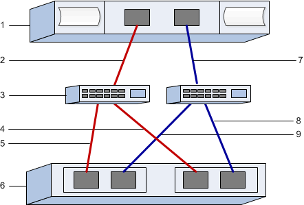

= EシリーズのVMware 向け NVMe over FC スイッチの設定
:allow-uri-read: 
:icons: font
:imagesdir: ../media/

[role="lead"]
NVMe over Fibre Channel プロトコルを使用する場合は、スイッチを設定し、ホストポート識別子を特定します。

NOTE: VMwareとの互換性を確保するため、4096バイトのドライブを使用する場合は、ボリュームを512バイトエミュレーション（512e）を使用するように設定する必要があります。ボリュームを512バイトエミュレーション（512e）を使用するように設定する方法の詳細については、SANtricity System Managerのオンラインヘルプを参照してください。

NOTE: NVMe over FC構成を計画する際には、 https://configmax.broadcom.com/guest["VMware Configuration Maximums Guide"^]にサーバーあたりでサポートされるNVMe FCイニシエータポートの最大数は2であると記載されています。パスの設定数が多くなりすぎないように、この要件を考慮する必要があります。

[[step-1-record-your-configuration]]
== ステップ1：設定を記録する

このページをPDFファイルとして生成して印刷し、その後、以下のワークシートを使用してNVMe over Fibre Channelストレージの構成情報を記録できます。プロビジョニング作業を行う際に、この情報が必要になります。

図は、2つのゾーンでEシリーズ ストレージ アレイに接続されたホストを示しています。一方のゾーンは赤い線で示され、もう一方のゾーンは青い線で示されています。各ゾーンには、イニシエータポートが1つと、全ターゲットポートの半分が含まれています。コントローラーポートの数は、コントローラーモデルおよびホスト インターフェイス カード（HIC）の数によって異なります。コントローラーあたり最大12個のポートが利用できる場合があります。必要に応じて追加のPDFを印刷してください。

[[host-identifiers]]
=== ホスト識別子

|===
| 番号 | ホスト（イニシエータ）ポート接続 | WWPN 

 a| 
1.
 a| 
ホスト
 a| 
_ 該当なし _

 a| 
2.
 a| 
ホストポート 0 から FC スイッチゾーン 0
 a| 

 a| 
7.
 a| 
ホストポート 1 から FC スイッチゾーン 1
 a| 

|===

[[target-identifiers]]
=== ターゲット識別子

|===
| 番号 | アレイコントローラ（ターゲット）ポート接続 | WWPN 

 a| 
3.
 a| 
スイッチ
 a| 
_ 該当なし _

 a| 
6.
 a| 
アレイコントローラ（ターゲット）
 a| 
_ 該当なし _

 a| 
5.
 a| 
コントローラ A のポート 1 から FC スイッチ 1
 a| 

 a| 
5.
 a| 
コントローラA、ポート2からFCスイッチ1へ
 a| 

 a| 
9.
 a| 
コントローラA、ポート3からFCスイッチ2へ
 a| 

 a| 
9.
 a| 
コントローラA、ポート4からFCスイッチ2へ
 a| 

 a| 
4.
 a| 
コントローラ B のポート 1 から FC スイッチ 1
 a| 

 a| 
4.
 a| 
コントローラB、ポート2からFCスイッチ1へ
 a| 

 a| 
8.
 a| 
コントローラB、ポート3からFCスイッチ2へ
 a| 

 a| 
8.
 a| 
コントローラB、ポート4からFCスイッチ2へ
 a| 

|===

[[host-mapping-information]]
=== ホストマッピング情報

[cols="35h,~"]
|===
| マッピングホスト名 |  

| ホスト OS タイプ |  

| ホスト NQN |  

| ターゲット NQN |  
|===

[[step-2-determine-the-host-ports-wwpns]]
== ステップ2：ホスト ポートのWWPNを特定する

FC ゾーニングを設定するためには、各イニシエータポートの World Wide Port Name （ WWPN ）を特定する必要があります。

.手順
. SSHまたはESXiシェルを使用してESXiホストに接続します。ESXiシェルを有効にするには、 https://knowledge.broadcom.com/external/article/311213/using-esxi-shell-in-esxi.html["ESXiでESXiシェルを使用する"^]を参照してください。
. 次のコマンドを実行します。
+
[listing]
----
esxcli storage core adapter list
----
. イニシエータのWWPN識別子（UID、形式はfc.WWNN:WWPN）を記録します。出力は次の例のようになります。
+
[listing]
----
HBA Name  Driver    Link State  UID                                   Capabilities         Description
--------  --------  ----------  ------------------------------------  -------------------  -----------
vmhba4    lpfc      link-up     fc.200070b7e4395530:100070b7e4395530  Second Level Lun ID  (0000:5e:00.0) Emulex Corporation Emulex LPe35000/LPe36000 Fibre Channel Adapter
vmhba5    lpfc      link-up     fc.200070b7e4395531:100070b7e4395531  Second Level Lun ID  (0000:5e:00.1) Emulex Corporation Emulex LPe35000/LPe36000 Fibre Channel Adapter
vmhba64   lpfc      link-up     fc.200070b7e4395530:100070b7e4395530                       (0000:5e:00.0) Emulex Corporation Emulex LPe35000/LPe36000 Fibre Channel Adapter
vmhba65   lpfc      link-up     fc.200070b7e4395531:100070b7e4395531                       (0000:5e:00.1) Emulex Corporation Emulex LPe35000/LPe36000 Fibre Channel Adapter

----

上記の例では、vmhba4とvmhba64、およびvmhba5とvmhba65のUIDは同一です。これは、FCPとNVMe over FCの両方をサポートするFCアダプタでは想定される動作です。それぞれの固有のWWPNを記録してください。

NOTE: 別のコマンドオプションは `esxcli storage san fc list`です。これにより、詳細情報と、コロンで区切られた16進数形式のWWPNが表示されます。

. 以下のコマンドを実行し、ホストのNQNを記録してください（これは後でホストマッピングを設定する際に必要になります）：
+
[listing]
----
esxcli nvme info get
----

[[step-3-configure-the-nvmefc-switches]]
== ステップ3：NVMe/FCスイッチの設定

NVMe over Fibre Channel （ FC ）スイッチを設定（ゾーニング）すると、ホストをストレージアレイに接続できるようになり、パスの数が制限されます。スイッチのゾーニングはスイッチの管理インターフェイスで設定します。

.作業を開始する前に
次のものがあることを確認します。

* スイッチの管理者クレデンシャル。
* 各ホストイニシエータポートの WWPN と、スイッチに接続されている各コントローラターゲットポートの WWPN 。（ HBA ユーティリティを使用して検出してください）。

NOTE: ベンダーの HBA ユーティリティを使用して、 HBA に関する具体的な情報をアップグレードおよび取得することができます。HBA ユーティリティの入手方法については、ベンダーの Web サイトでサポートのセクションを参照してください。

.このタスクについて
各イニシエータポートを別々のゾーンに配置し、各イニシエータに対応するターゲットポートをすべて配置する必要があります。スイッチのゾーニングの詳細については、スイッチベンダーのマニュアルを参照してください。

.手順
. FC スイッチの管理プログラムにログインし、ゾーニング設定のオプションを選択します。
. 新しいゾーンを作成し、 1 つ目のホストイニシエータポート、およびそのイニシエータと同じ FC スイッチに接続するすべてのターゲットポートを配置します。
. スイッチの FC ホストイニシエータごとにゾーンを作成します。
. ゾーンを保存し、新しいゾーニング設定をアクティブ化します。

ゾーン設定の詳細な手順については、スイッチベンダーのドキュメントを参照してください。
