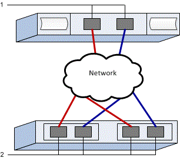

= EシリーズでVMware用のNVMe over TCPスイッチを設定する
:allow-uri-read: 
:icons: font
:imagesdir: ../media/

[role="lead"]
NVMe over TCP プロトコルの場合、スイッチを設定し、ホストの NVMe 修飾名（NQN）を決定します。

NOTE: VMwareとの互換性を確保するため、4096バイトのドライブを使用する場合は、ボリュームを512バイトエミュレーション（512e）を使用するように設定する必要があります。ボリュームを512バイトエミュレーション（512e）を使用するように設定する方法の詳細については、SANtricity System Managerのオンラインヘルプを参照してください。

[[step-1-record-your-configuration]]
== ステップ1：設定を記録する

このページをPDFファイルとして生成して印刷し、その後、次のワークシートを使用して、プロトコル固有のストレージ構成情報を記録することができます。プロビジョニング作業を行う際に、この情報が必要になります。

図は、VLANおよび/または固有のサブネットによって分離されたEシリーズ ストレージ アレイに接続されているホストを示しています。一方のVLAN/サブネットは青線で示され、もう一方のVLAN/サブネットは赤線で示されています。各VLAN/サブネットには、少なくとも1つのイニシエータポートと、ターゲットポートの半数が含まれます。ホストポートおよび/またはコントローラポートの数は、ネットワークインターフェースの数とコントローラのモデルによって異なります。コントローラーあたり最大6個のポートが利用できる場合があります。

[[host-mapping-information]]
=== ホストマッピング情報

[cols="35h,~"]
|===
| マッピングホスト名 |  

| ホスト OS タイプ |  

| ホスト NQN |  

| ターゲット NQN |  
|===

[[step-2-configure-the-nvmetcp-switches]]
== ステップ2：NVMe/TCPスイッチの設定

NVMe over TCPに関するベンダーの推奨事項に従って、スイッチを設定します。これらの推奨事項には、設定指示とコードの更新の両方が含まれる可能性があります。

.このタスクについて
このタスクでは、TCP 経由の NVMe 用にスイッチを設定するための一般的な手順について説明します。具体的な手順については、スイッチベンダーのマニュアルを参照してください。

.作業を開始する前に
次のものがあることを確認します。

* 高可用性のための2つの独立したネットワーク。NVMe over TCPトラフィックは、必ず別のネットワークセグメントに分離してください。

.手順
スイッチベンダーのマニュアルを参照してください。

[[step-3-configure-networking]]
== ステップ3：ネットワークの設定

NVMe over TCPネットワークは、データストレージの要件に応じて、さまざまな方法で設定できます。環境に最適な構成を選択するためのヒントについては、ネットワーク管理者にお問い合わせください。

.このタスクについて
このタスクでは、TCP 上で NVMe 用のネットワークを構成するための一般的な手順について説明します。具体的な手順については、スイッチベンダーのマニュアルを参照してください。

.作業を開始する前に
次のものがあることを確認します。

* TCPトラフィック用に設定されたスイッチ。

TCP 経由の NVMe ネットワークを計画する際には、 https://configmax.broadcom.com/guest["VMware Configuration Maximums Guide"^]にサーバーあたりにサポートされる最大 TCP NVMe イニシエータポート数は 2 であると規定されています。パスの設定数が多くなりすぎないように、この要件を考慮する必要があります。

良好なマルチパス構成を確保するには、NVMe over TCP ネットワークに複数のネットワークセグメントを使用してください。ホスト側のポートを少なくとも 1 つ、および各アレイコントローラのポートを少なくとも 1 つ、1 つのネットワークセグメントに配置し、ホスト側とアレイ側のポートの同一のグループを別のネットワークセグメントに配置します。可能な限り、複数のイーサネットスイッチを使用して冗長性を高めてください。

.手順
スイッチベンダーのマニュアルを参照してください。

[[step-4-configure-array-side-networking]]
== ステップ4：アレイ側のネットワークを設定する

SANtricity System Manager インターフェイスを使用して、アレイ側で NVMe over TCP ネットワークを設定します。

.このタスクについて
このタスクでは、SANtricity System Manager の *コントローラーとコンポーネント* ページから NVMe over TCP ポート構成にアクセスする方法について説明します。また、SANtricity System Manager の *NVMe over TCP ポートの設定* ページから設定にアクセスすることもできます。

.作業を開始する前に
次のものがあることを確認します。

* いずれかのストレージアレイコントローラの IP アドレスまたはドメイン名。
* System ManagerのGUIのパスワード、またはロールベースアクセス制御（RBAC）もしくはLDAPとディレクトリサービスが、ストレージアレイへの適切なセキュリティアクセス用に設定されています。link:https://docs.netapp.com/us-en/e-series-santricity/um-certificates/overview-access-management-um.html["アクセス管理"^]の詳細については、SANtricity System Managerのオンラインヘルプを参照してください。

.手順
. ブラウザから、次のURLを入力します。 https://<DomainNameOrIPAddress>[]
+
「 IPAddress 」は、ストレージアレイコントローラの 1 つのアドレスです。

+
設定されていないアレイで初めて SANtricity システムマネージャを開くと、管理者パスワードの設定プロンプトが表示されます。ロールベースアクセス管理では、 admin 、 support 、 security 、 monitor の 4 つのローカルロールが設定されます。最後の 3 つのロールには、推測されにくいランダムなパスワードが設定されています。admin ロールのパスワードを設定したら、 admin クレデンシャルを使用してすべてのパスワードを変更できます。4 つのローカルユーザロールの詳細については、 SANtricity System Manager オンラインヘルプを参照してください。

. 管理者パスワードの設定フィールドとパスワードの確認フィールドに管理者ロールの System Manager パスワードを入力し、 * パスワードの設定 * をクリックします。
+
プール、ボリューム グループ、ワークロード、または通知が設定されていない場合、セットアップ ウィザードが起動します。

. セットアップウィザードを閉じます。
+
このウィザードは、あとで追加のセットアップタスクを実行する際に使用します。

. *Hardware* > *Controllers and components* を選択します。
. 設定するNVMe over TCPポートを持つコントローラーをクリックします。
+
コントローラのコンテキストメニューが表示されます。

. 「NVMe over TCP ポートの設定」を選択します。
+
「TCP経由のNVMeポートの設定」ダイアログボックスが開きます。

. ドロップダウンリストで、設定するポートを選択し、 * Next * をクリックします。
. 構成ポートの設定を選択し、 * 次へ * をクリックします。
+
すべてのポート設定を表示するには、ダイアログボックスの右側にある * Show more port settings * リンクをクリックします。

+
|===
| ポートの設定 | 説明 

 a| 
イーサネットポート速度の設定
 a| 
希望の速度を選択してください。ドロップダウンリストに表示されるオプションは、ネットワークがサポートできる最大速度（例：200 Gb/s）によって異なります。

 a| 
IPv4 を有効にする / IPv6 を有効にする
 a| 
一方または両方のオプションを選択して、 IPv4 ネットワークと IPv6 ネットワークのサポートを有効にします。

 a| 
MTUサイズ（「その他のポート設定を表示」をクリックすると表示されます。）
 a| 
必要に応じて、 Maximum Transmission Unit （ MTU ；最大伝送ユニット）の新しいサイズをバイト単位で入力します。

デフォルトのMTUサイズは4200バイト / フレームです。1500～9000の値を入力する必要があります。

|===
+
[*IPv4 を有効にする *] を選択した場合は、 [ 次へ *] をクリックすると、 IPv4 設定を選択するためのダイアログボックスが開きます。[*IPv6 を有効にする *] を選択した場合、 [ 次へ *] をクリックすると、 IPv6 設定を選択するためのダイアログボックスが開きます。両方のオプションを選択した場合は、 IPv4 設定のダイアログボックスが最初に開き、 * 次へ * をクリックすると、 IPv6 設定のダイアログボックスが開きます。

+
IPv4 と IPv6 、またはその両方を自動または手動で設定します。すべてのポート設定を表示するには、ダイアログボックスの右側にある * Show more settings * リンクをクリックします。

+
|===
| ポートの設定 | 説明 

 a| 
自動的に設定を取得します
 a| 
設定を自動的に取得するには、このオプションを選択します。

 a| 
静的な設定を手動で指定します
 a| 
このオプションを選択した場合は、フィールドに静的アドレスを入力します。IPv4 の場合は、ネットワークのサブネットマスクとゲートウェイも指定します。IPv6 の場合は、ルーティング可能な IP アドレスとルータの IP アドレスも指定します。

|===
. [ 完了 ] をクリックします。
. System Manager を終了します。

[[step-5-configure-host-side-networking]]
== ステップ 5：ホスト側のネットワークを設定する

ホスト側でNVMe over TCPネットワークを構成することで、VMware NVMe over TCPストレージアダプタのイニシエータがアレイとのセッションを確立できるようになります。

.手順
. TCPネットワークアダプタを特定し、vmnicとペアになっているアップリンクを記録します。
+
ホスト上のネットワークアダプタはvmnicNという名前で、Nはネットワークアダプタを識別する一意の番号です。例えば、vmnic0、vmnic1などです。物理アダプタは、ESXiホストの「ネットワーク」の下、またはホスティングのvCenterのインベントリからESXiホストを選択した状態で「構成」タブから確認できます。

. vSphere標準スイッチを使用して、TCPアダプタのVMkernelポートバインディングを設定します。
+
詳細については、link:https://techdocs.broadcom.com/us/en/vmware-cis/vsphere/vsphere/9-1/vsphere-storage/about-vmware-nvme-storage/configuring-nvme-over-tcp-on-esxi/configure-vmkernel-binding-for-the-tcp-adapter.html["TCPアダプタのVMkernelバインディングを設定する"^]を参照してください。

. ソフトウェア NVMe over TCP アダプタを追加します。
+
詳細については、link:https://techdocs.broadcom.com/us/en/vmware-cis/vsphere/vsphere/9-1/vsphere-storage/about-vmware-nvme-storage/configuring-nvme-over-tcp-on-esxi/configure-vmkernel-binding-for-the-tcp-adapter/configure-vmkernel-binding-for-the-tcp-adapter-with-a-vsphere-standard-switch.html["ソフトウェアNVMe over RDMAまたはNVMe over TCPアダプタを追加する"^]を参照してください。

. NVMe over TCP用のNVMeコントローラを追加します。
+
詳細については、link:https://techdocs.broadcom.com/us/en/vmware-cis/vsphere/vsphere/9-1/vsphere-storage/about-vmware-nvme-storage/configuring-nvme-over-tcp-on-esxi/shared-content/submaps/GUID-23E6D699-BEDC-4B5F-9515-3390C0E73888_copy.html["NVMe over Fabrics用のコントローラを追加する"^]を参照してください。

NOTE: ホスト NQN は、このプロセス中に「コントローラの追加」ダイアログボックスから取得できます。これは後でホスト マッピングを設定する際に必要になります。

正常に追加されると、vSphere Client のストレージ アダプタ ビューから接続を確認できます。うまくいかない場合は、手順 6 に進み、ポートへの通信を確認して接続設定を修正してください。

[[step-6-verify-ip-network-connections]]
== ステップ6：IPネットワーク接続を確認する

インターネットプロトコル（ IP ）ネットワーク接続を確認するには、 ping テストを使用してホストとアレイが通信できることを確認します。

.手順
. ホストで、次のコマンドを実行します。
+
[listing]
----
vmkping <NVMe over TCP_target_IP_address\>
----
+
この例では、NVMe over TCP のターゲット IP アドレスは 192.29.11.111 です。

+
[listing]
----
vmkping -d 192.29.11.111
PING 192.29.11.111 (192.29.11.111): 56 data bytes
64 bytes from 192.29.11.111: icmp_seq=0 ttl=64 time=0.902 ms
64 bytes from 192.29.11.111: icmp_seq=1 ttl=64 time=0.406 ms
64 bytes from 192.29.11.111: icmp_seq=2 ttl=64 time=0.855 ms
--- 192.29.11.111 ping statistics ---
3 packets transmitted, 3 packets received, 0% packet loss
round-trip min/avg/max = 0.406/0.721/0.902 ms
----
. 各ホストのイニシエータアドレス（NVMe over TCP に使用されるホスト イーサネット ポートの IP アドレス）から各コントローラの NVMe over TCP ポートに対して、 `vmkping`コマンドを実行してください。構成内の各ホスト サーバーでこの操作を実行し、必要に応じて IP アドレスを変更してください。
+

NOTE: コマンドが次のメッセージで失敗した場合 `sendto() failed (Message too long)`、ホスト サーバー、ストレージ コントローラ、およびスイッチ ポート上のイーサネット インターフェイスのMTUサイズを確認します。

. ステップ5の検出が失敗した場合は、NVMe over TCPホスト側ネットワーク構成手順に戻り、ターゲットコントローラの追加を完了してください。

