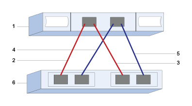

= EシリーズでVMwareのSASホスト インターフェイスと設定を構成する
:allow-uri-read: 
:icons: font
:imagesdir: ../media/

[role="lead"]
SAS プロトコルの場合は、ホストポートアドレスを特定し、推奨設定を適用します。

[[step-1-record-your-configuration]]
== ステップ1：設定を記録する

このページをPDFファイルとして生成して印刷し、その後、次のワークシートを使用して、プロトコル固有のストレージ構成情報を記録することができます。プロビジョニング作業を行う際に、この情報が必要になります。

図は、冗長接続（4ポート SAS HBA を想定）を備えた Eシリーズ ストレージ アレイにホストが直接接続されていることを示しています。最初の冗長接続は赤い線で示され、2番目の冗長接続は青い線で示されています。ポート数はホスト ポートの数によって決まります。ホスト ポートは2つしか利用できない場合があります。この場合、少なくとも最初の冗長接続を設けることを推奨します。

[[host-identifiers]]
=== ホスト識別子

|===
| 番号 | ホスト（イニシエータ）ポート接続 | SAS アドレス 

 a| 
1.
 a| 
ホスト
 a| 
_ 該当なし _

 a| 
2.
 a| 
ホスト（イニシエータ）ポート 1 からコントローラ A のポート 1
 a| 

 a| 
3.
 a| 
ホスト（イニシエータ）ポート 2 からコントローラ B のポート 1
 a| 

 a| 
4.
 a| 
ホスト（イニシエータ）のポート3がコントローラAのポート1に接続されています
 a| 

 a| 
5.
 a| 
ホスト（イニシエータ）ポート4がコントローラB、ポート1に接続されています。
 a| 

|===

[[host-mapping-information]]
=== ホストマッピング情報

[cols="35h,~"]
|===
| マッピングホスト名 |  

| ホスト OS タイプ |  
|===

[[step-2-determine-sas-host-identifiers]]
== ステップ2：SASホスト識別子を特定する

esxcliまたはHBAユーティリティを使用してSASアドレスを検索します。

.このタスクについて
HBA ユーティリティのガイドラインを確認します。

* ほとんどの HBA ベンダーは HBA ユーティリティを提供しています。

.手順
. SSHまたはESXiシェルを使用してESXiホストに接続します。ESXiシェルを有効にするには、 https://knowledge.broadcom.com/external/article/311213/using-esxi-shell-in-esxi.html["ESXiでESXiシェルを使用する"^]を参照してください。
. 次のコマンドを実行します。
+
[listing]
----
esxcli storage core adapter list
----
. イニシエータ SAS アドレス識別子（sas.<SAS_Address> の形式の UID）を記録します。出力は次の例のようになります。
+
[listing]
----
HBA Name  Driver       Link State  UID                   Capabilities         Description
--------  ----------   ----------  --------------------  -------------------  -----------
vmhba1    lsi_msgpt35  link-n/a    sas.5b083fe0ca0e7000                       (0000:03:00.0) Avago (LSI Logic) SAS3008 12Gbps SAS HBA external
----

上記の例では、UIDにはベースとなるSASアドレスのみが表示されます。他のポートについては、最初の14文字は一定で、最後の2文字だけが異なるポートを表すために変化します。通常、ポートごとに最後の桁が1ずつ増加します。ベースSASアドレスがあれば、EシリーズアレイがホストマッピングB中にその他のポートSASアドレスを自動的に検出して一覧表示するため、通常はホスト アダプタの識別に十分です。ベンダー提供のHBAユーティリティを使用すると、各ポートのSASアドレスを取得できる場合があります。

NOTE: 別のコマンドオプションは `esxcli storage san sas list`です。これにより、詳細情報とベースとなるSASアドレスがコロンで区切られた16進数形式で表示されます。
