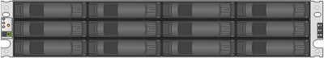
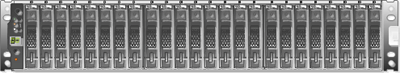
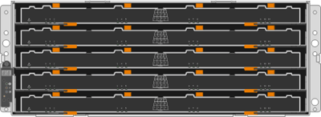

= Eシリーズシェルフタイプの詳細
:allow-uri-read: 
:icons: font
:imagesdir: ../media/

[role="lead"]
E シリーズシステムは、さまざまなシェルフサイズで提供されます。

|===
| シェルフタイプ | 図 

 a| 
* DE212C ： *

* 2u12 （ 2 ラックユニット、 12 ドライブ）
* 3.5 インチ HDD または 2.5 インチ SSD （アダプタ搭載）
* EF50、EF80、E4000、E2800コントローラ

 a| 

 a| 
* DE224C ： *

* 2u24 （ 2 ラックユニット、 24 ドライブ）
* 2.5 インチ HDD または 2.5 インチ SSD
* EF50、EF80、E2800、EF280、E5700、およびEF570コントローラ

 a| 

 a| 
* DE460C ： *

* 4u60 （ 4 ラックユニット、 60 ドライブ）
* 3.5 インチドライブ、 2.5 インチドライブ（ NL-SAS 、 SAS 、 SSD ）
* EF50、EF80、E4000、E2800、およびE5700コントローラー

 a| 

|===