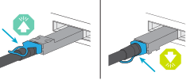
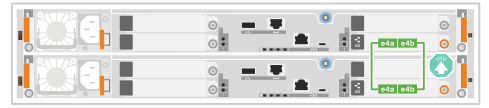
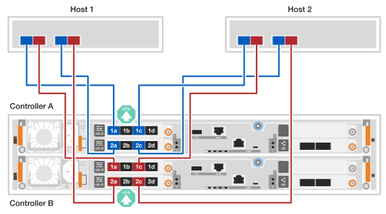
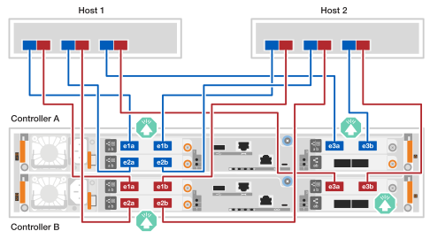
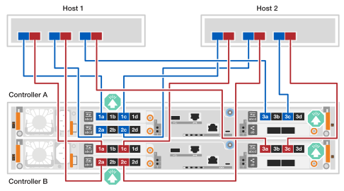
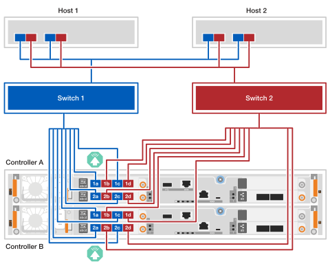
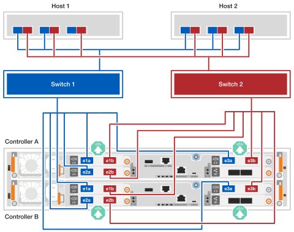
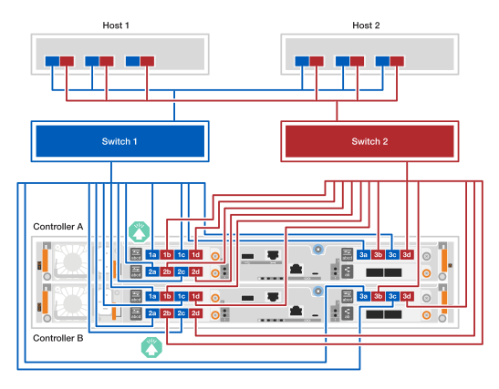
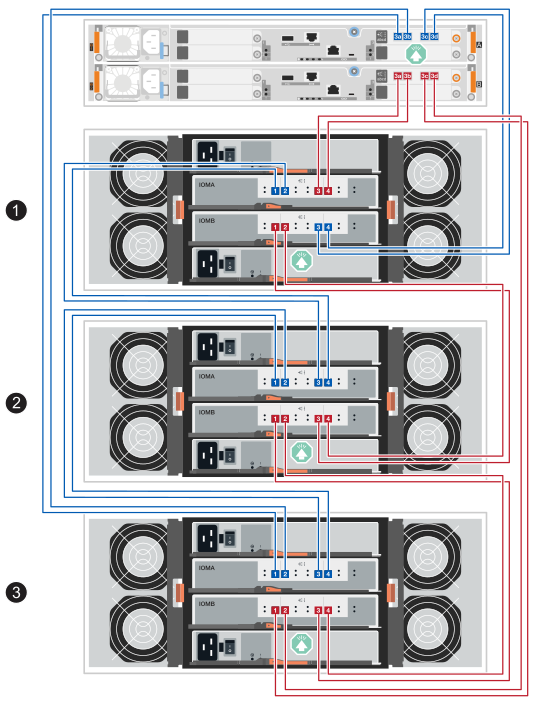

= EF50およびEF80ストレージシステムのハードウェアをケーブル接続する
:allow-uri-read: 
:icons: font
:imagesdir: ../media/

[role="lead"]
EF50またはEF80ストレージシステムのハードウェアをインストールしたら、コントローラー間のミラーリング、ホストネットワーク接続、および必要に応じてSASシェルフのケーブル接続を行います。（管理ポートのケーブル接続は、後ほど「ストレージシステムセットアップの完了」セクションで行います。）

.このタスクについて
* この手順では、「I/O モジュール」という用語は、ホスト インターフェイス カード（HIC）を指すために使用されます。
* ケーブル配線図には、コネクタをポートに挿入する際のケーブル コネクタの引き抜きタブの正しい向き（上向きまたは下向き）を示す矢印アイコンが付いています。
+
コネクタを差し込むと、カチッと音がして所定の位置に収まるはずです。音がしない場合は、一度取り外して裏返し、もう一度試してください。

+

[[step-1-cable-the-inter-controller-mirroring-connections]]
== 手順1：コントローラ間ミラーリング接続をケーブル接続する

コントローラ同士をケーブルで接続して、コントローラ間のミラーリング機能を有効にします。コントローラ間のミラーリング接続は、システム全体の冗長性を確保し、キャッシュ ミラーリングやI/O転送に使用されます。EF50とEF80ストレージ システムのケーブル配線は同じです。

NOTE: ストレージシステムに搭載されているコントローラ間ミラーリングI/Oモジュールの速度（ストレージシステムがサポートする100GbEまたは200GbE）に関わらず、付属の200GbEケーブルを使用します。コントローラ間ミラーリングI/Oモジュールの速度が100GbEの場合、接続は低速（100GbE）で動作します。

.手順
. コントローラを相互に接続します：
+
.. コントローラAのポートe4aをコントローラBのポートe4aにケーブルで接続します。
.. ケーブルコントローラAポートe4bからコントローラBポートe4bへ。
+
*200 GbE イーサネットケーブル*

+

+

[[step-2-cable-the-host-connections]]
== ステップ2：ホスト接続をケーブル接続する

ストレージシステムのホスト接続は、ネットワークトポロジー（直接接続またはファブリック接続）に応じて配線してください。

.このタスクについて
* ストレージシステムのモデルと実行中の SANtricity のバージョンによって、サポートされるホスト I/O モジュールの種類が異なります。この手順で示すケーブル配線の例では、イーサネットおよびファイバーチャネル（FC）ホスト I/O モジュールを使用しています。
+
お使いのストレージシステムモデルでサポートされているすべてのホストI/Oモジュールとスロットの優先順位を確認するには、link:https://hwu.netapp.com["NetApp Hardware Universe の略"^]を参照してください。

* 配線例では、ホスト1とホスト2に4ポート64Gb FC HBAは示されていませんが、これらがインストールされている場合は、2ポートHBAの場合と同様に、1つおきのポートを配線してください。

[role="tabbed-block"]
====
.直接接続トポロジー
--
以下の例は、直接接続トポロジーを使用してストレージシステムをホストにケーブル接続する方法を示しています。

.EF50（2個の4ポート64Gb FC I/Oモジュール搭載）
[%collapsible]
=====
.このタスクについて
* ケーブル配線の例では、ホストI/Oモジュールがスロット1と2に装着されています。これは、EF50ストレージシステムでサポートされるホストI/Oモジュールの最大数です。ただし、スロット1のホストI/Oモジュールのみが必要であり、スロット2のホストI/Oモジュールはオプションです。
+
ストレージシステムにホストI/Oモジュールが1つ搭載されている場合は、追加のホストI/Oモジュールへのケーブル接続は無視して、搭載済みのホストI/Oモジュールにのみケーブル接続できます。

* 直接接続型ストレージシステムには、冗長性を確保するための2つの独立したパスがあります：パスAとパスB。
+
** パスAの接続は、ホストおよびコントローラ上の青色のケーブルと青色のポートで示されています。各ホスト上のHBAポートをコントローラAのポートaおよびcに接続します。
** パスBの接続は、ホストおよびコントローラ上の赤いケーブルと赤いポートで示されています。各ホストのHBAポートをコントローラBのポートaおよびcに接続します。

* ケーブル接続の例ではI/Oモジュールのポートaとcがホストに接続されていますが、ポートaとb、またはポートcとdを使用することもできます。

.手順
. ホストをコントローラにケーブルで接続します：
+
.. ケーブルホスト1のパスA（青色）HBAポートをコントローラAのaポート（1aおよび2a）に接続します。
.. ケーブルホスト1のパスB（赤色）HBAポートをコントローラBのaポート（1aおよび2a）に接続します。
.. ケーブルホスト2のパスA（青色）のHBAポートをコントローラAのcポート（1cと2c）に接続します。
.. ケーブルホスト2のパスB（赤色）のHBAポートをコントローラBのcポート（1cと2c）に接続します。
+
*64 Gb/s FCケーブル*

+

+

=====
.3つの2ポート200 GbE I/Oモジュールを備えたEF80
[%collapsible]
=====
.このタスクについて
* ケーブル配線の例では、ホストI/Oモジュールがスロット1、2、3に装着されています。これは、EF80ストレージシステムでサポートされるホストI/Oモジュールの最大数です。ただし、スロット1のホストI/Oモジュールのみが必要であり、スロット2とスロット3のホストI/Oモジュールはどちらもオプションです。
+
ストレージシステムに搭載されているホストI/Oモジュールの数が少ない場合は、追加のホストI/Oモジュールへのケーブル接続は無視して、既に搭載されているホストI/Oモジュールにのみケーブル接続すれば構いません。

* 直接接続型ストレージシステムには、冗長性を確保するための2つの独立したパスがあります：パスAとパスB。
+
** パスAの接続は、ホストおよびコントローラ上の青色のケーブルと青色のポートで示されています。各ホストのHBAポートをコントローラAのポートaおよびbに接続します。
** パスBの接続は、ホストおよびコントローラ上の赤いケーブルと赤いポートで示されています。各ホストのHBAポートをコントローラBのポートaおよびbに接続します。

.手順
. ホストをコントローラにケーブルで接続します：
+
.. ケーブルホスト1のパスA（青色）HBAポートをコントローラAのaポート（e1a、e2a、e3a）に接続します。
.. ケーブルホスト1のパスB（赤色）HBAポートをコントローラBのaポート（e1a、e2a、e3a）に接続します。
.. ケーブルホスト2のパスA（青色）のHBAポートをコントローラAのbポート（e1b、e2b、e3b）に接続します。
.. ケーブルホスト2のパスB（赤色）のHBAポートをコントローラBのbポート（e1b、e2b、e3b）に接続します。
+
*200 GbE ケーブル*

+

+

=====
.3つの4ポート64Gb FC I/Oモジュールを搭載したEF80
[%collapsible]
=====
.このタスクについて
* ケーブル配線の例では、ホストI/Oモジュールがスロット1、2、3に装着されています。これは、EF80ストレージシステムでサポートされるホストI/Oモジュールの最大数です。ただし、スロット1のホストI/Oモジュールのみが必要であり、スロット2とスロット3のホストI/Oモジュールはどちらもオプションです。
+
ストレージシステムに搭載されているホストI/Oモジュールの数が少ない場合は、追加のホストI/Oモジュールへのケーブル接続は無視して、既に搭載されているホストI/Oモジュールにのみケーブル接続すれば構いません。

* 直接接続型ストレージシステムには、冗長性を確保するための2つの独立したパスがあります：パスAとパスB。
+
** パスAの接続は、ホストおよびコントローラ上の青色のケーブルと青色のポートで示されています。各ホスト上のHBAポートをコントローラAのポートaおよびcに接続します。
** パスBの接続は、ホストおよびコントローラ上の赤いケーブルと赤いポートで示されています。各ホストのHBAポートをコントローラBのポートaおよびcに接続します。

* ケーブル接続の例ではI/Oモジュールのポートaとcがホストに接続されていますが、ポートaとb、またはポートcとdを使用することもできます。

.手順
. ホストをコントローラにケーブルで接続します：
+
.. ケーブルホスト1のパスA（青色）HBAポートをコントローラAのaポート（1a、2a、3a）に接続します。
.. ケーブルホスト1のパスB（赤）HBAポートをコントローラBのaポート（1a、2a、3a）に接続します。
.. ケーブルホスト2のパスA（青色）のHBAポートをコントローラAのcポート（1c、2c、3c）に接続します。
.. ケーブルホスト2のパスB（赤色）のHBAポートをコントローラBのcポート（1c、2c、3c）に接続します。
+
*64 Gb/s FCケーブル*

+

+

=====
--
.ファブリック接続型トポロジー
--
以下の例は、ファブリック接続トポロジーを使用してストレージシステムをホストにケーブル接続する方法を示しています。

.EF50（2個の4ポート64Gb FC I/Oモジュール搭載）
[%collapsible]
=====
.このタスクについて
* ケーブル配線の例では、ホストI/Oモジュールがスロット1と2に装着されています。これは、EF50ストレージシステムでサポートされるホストI/Oモジュールの最大数です。ただし、スロット1のホストI/Oモジュールのみが必要であり、スロット2のホストI/Oモジュールはオプションです。
+
ストレージシステムにホストI/Oモジュールが1つ搭載されている場合は、追加のホストI/Oモジュールへのケーブル接続は無視して、搭載済みのホストI/Oモジュールにのみケーブル接続できます。

* ファブリック接続型ストレージシステムには、冗長性を確保するために、switch 1パスとswitch 2パスという2つの独立したスイッチパスがあります。
+
** スイッチ1のパス接続は、ホストおよびコントローラ上の青色のケーブルと青色のポートで示されています。これは、スイッチ1を介して各ホストのHBAポートをコントローラAとコントローラBのaポートおよびcポートに接続します。
** スイッチ2のパス接続は、ホストおよびコントローラ上の赤いケーブルと赤いポートで示されています。これは、スイッチ2を介して各ホストのHBAポートをコントローラAとコントローラBのbポートおよびdポートに接続します。

.手順
. ホストをスイッチに接続します。
+
スイッチのどのポートでも使用できます。

+
.. ケーブルホスト1とホスト2のスイッチ1パス（青色）のHBAポートをスイッチ1に接続します。
.. ケーブルホスト1およびホスト2スイッチ2パス（赤）HBAポートをスイッチ2に接続します。

. スイッチをコントローラに接続します：
+
.. ケーブルスイッチ1（青色）をコントローラAのaポートとcポート（1a、2a、1c、2c）に接続します。
.. ケーブルスイッチ1（青色）をコントローラBのaポートとcポート（1a、2a、1c、2c）に接続します。
.. ケーブルスイッチ2（赤色）をコントローラAのbポートとdポート（1b、2b、1d、2d）に接続します。
.. ケーブルスイッチ2（赤色）をコントローラBのbポートとdポート（1b、2b、1d、2d）に接続します。
+
*64 Gb/s FCケーブル*

+

+

=====
.3つの2ポート200 GbE I/Oモジュールを備えたEF80
[%collapsible]
=====
.このタスクについて
* ケーブル配線の例では、ホストI/Oモジュールがスロット1、2、3に装着されています。これは、EF80ストレージシステムでサポートされるホストI/Oモジュールの最大数です。ただし、スロット1のホストI/Oモジュールのみが必要であり、スロット2とスロット3のホストI/Oモジュールはどちらもオプションです。
+
ストレージシステムに搭載されているホストI/Oモジュールの数が少ない場合は、追加のホストI/Oモジュールへのケーブル接続は無視して、既に搭載されているホストI/Oモジュールにのみケーブル接続すれば構いません。

* ケーブル接続の例では、各ホストに3つのHBAが搭載されています。ホストに搭載されているHBAが3つ未満の場合は、追加のHBAへのケーブル接続は無視して、インストールされているHBAにのみケーブル接続してください。
* ファブリック接続型ストレージシステムには、冗長性を確保するために、switch 1パスとswitch 2パスという2つの独立したスイッチパスがあります。
+
** スイッチ1のパス接続は、ホストおよびコントローラ上の青色のケーブルと青色のポートで示されています。これは、スイッチ1を介して各ホストのHBAポートをコントローラAとコントローラBのaポートに接続します。
** スイッチ2のパス接続は、ホストおよびコントローラ上の赤いケーブルと赤いポートで示されています。これは、スイッチ2を介して各ホストのHBAポートをコントローラAとコントローラBのbポートに接続します。

.手順
. ホストをスイッチに接続します：
+
スイッチのどのポートでも使用できます。

+
.. ケーブルホスト1とホスト2のスイッチ1パス（青色）のHBAポートをスイッチ1に接続します。
.. ケーブルホスト1およびホスト2スイッチ2パス（赤）HBAポートをスイッチ2に接続します。

. スイッチをコントローラに接続します：
+
.. ケーブルスイッチ1（青色）をコントローラAのaポート（e1a、e2a、e3a）に接続します。
.. ケーブルスイッチ1（青色）をコントローラBのaポート（e1a、e2a、e3a）に接続します。
.. ケーブルスイッチ2（赤色）をコントローラAのbポート（e1b、e2b、e3b）に接続します。
.. ケーブルスイッチ2（赤色）をコントローラBのbポート（e1b、e2b、e3b）に接続します。
+
*200 GbE ケーブル*

+

+

=====
.3つの4ポート64Gb FC I/Oモジュールを搭載したEF80
[%collapsible]
=====
.このタスクについて
* ケーブル配線の例では、ホストI/Oモジュールがスロット1、2、3に装着されています。これは、EF80ストレージシステムでサポートされるホストI/Oモジュールの最大数です。ただし、スロット1のホストI/Oモジュールのみが必要であり、スロット2とスロット3のホストI/Oモジュールはどちらもオプションです。
+
ストレージシステムに搭載されているホストI/Oモジュールの数が少ない場合は、追加のホストI/Oモジュールへのケーブル接続は無視して、既に搭載されているホストI/Oモジュールにのみケーブル接続すれば構いません。

* ケーブル接続の例では、各ホストに3つのHBAが搭載されています。ホストに搭載されているHBAが3つ未満の場合は、追加のHBAへのケーブル接続は無視して、インストールされているHBAにのみケーブル接続してください。
* ファブリック接続型ストレージシステムには、冗長性を確保するために、switch 1パスとswitch 2パスという2つの独立したスイッチパスがあります。
+
** スイッチ1のパス接続は、ホストおよびコントローラ上の青色のケーブルと青色のポートで示されています。これは、スイッチ1を介して各ホストのHBAポートをコントローラAとコントローラBのaポートおよびcポートに接続します。
** スイッチ2のパス接続は、ホストおよびコントローラ上の赤いケーブルと赤いポートで示されています。これは、スイッチ2を介して各ホストのHBAポートをコントローラAとコントローラBのbポートおよびdポートに接続します。

.手順
. ホストをスイッチに接続します：
+
スイッチのどのポートでも使用できます。

+
.. ケーブルホスト1とホスト2のスイッチ1パス（青色）のHBAポートをスイッチ1に接続します。
.. ケーブルホスト1およびホスト2スイッチ2パス（赤）HBAポートをスイッチ2に接続します。

. スイッチをコントローラに接続します：
+
.. ケーブルスイッチ1（青色）をコントローラAのaポートとcポート（1a、2a、3a、1c、2c、3c）に接続します。
.. ケーブルスイッチ1（青色）をコントローラBのaポートとcポート（1a、2a、3a、1c、2c、3c）に接続します。
.. ケーブルスイッチ2（赤色）をコントローラAのbポートとdポート（1b、2b、3b、1d、2d、3d）に接続します。
.. ケーブルスイッチ2（赤色）をコントローラBのbポートとdポート（1b、2b、3b、1d、2d、3d）に接続します。
+
*64 Gb/s FCケーブル*

+

+

=====
--
====

[[step-3-cable-the-sas-shelf-connections]]
== ステップ3：SASシェルフ接続ケーブルを接続する

以下の手順では、コントローラを1台のDE460Cシェルフ、または3台のDE460Cシェルフのスタックにケーブル接続する方法を示します。

.このタスクについて
* ケーブル配線の例ではDE460Cシェルフを示していますが、同じケーブル配線はサポートされているすべてのSASシェルフに適用できます。サポートされているSASシェルフについては、link:https://hwu.netapp.com["NetApp Hardware Universe の略"^]を参照してください。
* ストレージシステムでサポートされる最大シェルフ数と、光ファイバーなどのすべてのケーブルオプションについては、link:https://hwu.netapp.com["NetApp Hardware Universe の略"^]を参照してください。
* 配線手順では、スロット3にSAS I/Oモジュールが1つ搭載されたコントローラが示されています。これは、SANtricity 12.10でサポートされている唯一のSAS I/Oモジュール構成です。
* 配線図では、コントローラーAの配線は青色で、コントローラーBの配線は赤色で示されています。
* ケーブル配線図に示すように、コントローラーと1つ以上のシェルフを常にケーブル接続して、A側パス（IOMA）とB側パス（IOMB）用に2つのケーブル接続ができるようにしてください。
* ストレージシステムに付属のストレージケーブルを使用します。ケーブルの種類は以下のとおりです。
+
*ミニSAS HDケーブル*

+

[role="tabbed-block"]
====
.オプション1：DE460C シェルフ1台
--
各コントローラをDE460Cシェルフ上の各IOM12モジュールにケーブルで接続し、コントローラがシェルフに対してA側パス（IOMA）とB側パス（IOMB）を持つようにします。

.手順
. ケーブルコントローラAのポート3aをシェルフのIOMAポート1に接続します。
. ケーブルコントローラAのポート3bをシェルフIOMAのポート2に接続します。
. ケーブルコントローラAのポート3cをシェルフIOMBのポート3に接続します。
. ケーブルコントローラAのポート3dをシェルフIOMBのポート4に接続します。
. ケーブルコントローラBのポート3aをシェルフのIOMAポート3に接続します。
. ケーブルコントローラBのポート3bをシェルフのIOMAポート4に接続します。
. ケーブルコントローラBのポート3cをシェルフのIOMBポート1に接続します。
. ケーブルコントローラBのポート3dをシェルフのIOMBポート2に接続します。

シェルフのケーブル接続が完了すると、ケーブル接続は以下のようになります。

image:../media/drw_ef50-ef80_1_de460c_cabling_ieops-2981.svg["ケーブルコントローラポートをDE460Cシェルフ1つに接続します。"]

--
.オプション2：DE460C シェルフ3台
--
3つのシェルフを互いに接続し（シェルフ間接続）、次に各コントローラをシェルフスタックの両端（シェルフ1とシェルフ3）に接続して、コントローラがシェルフスタックに対してA側パス（IOMA）とB側パス（IOMB）を持つようにします。

. IOMAパス用の棚間接続ケーブルを配線します。
+
.. 棚1のIOMAポート1から棚2のIOMAポート4へケーブルを接続します。
.. シェルフ1のIOMAポート2をシェルフ2のIOMAポート3にケーブル接続します。
.. シェルフ2のIOMAポート1をシェルフ3のIOMAポート4にケーブル接続します。
.. ケーブル棚2のIOMAポート2から棚3のIOMAポート3へケーブルを接続します。

. IOMBパス用の棚間接続ケーブルを配線します。
+
.. 棚1のIOMBポート1から棚2のIOMBポート3へケーブルを接続します。
.. シェルフ1のIOMBポート2をシェルフ2のIOMBポート4にケーブル接続します。
.. シェルフ2のIOMBポート1をシェルフ3のIOMBポート3にケーブル接続します。
.. 棚2のIOMBポート2から棚3のIOMBポート4へケーブルを接続します。

. ケーブルコントローラAをシェルフ3（IOMAパス）とシェルフ1（IOMBパス）に接続します。
+
.. ケーブルコントローラAのポート3aからシェルフ3のIOMAポート1へ
.. ケーブルコントローラAのポート3bをシェルフ3のIOMAポート2に接続します。
.. ケーブルコントローラAのポート3cをシェルフ1のIOMBポート3に接続します。
.. ケーブルコントローラAのポート3dをシェルフ1のIOMBポート4に接続します。

. ケーブルコントローラBをシェルフ1（IOMAパス）とシェルフ3（IOMBパス）に接続します：
+
.. ケーブルコントローラBのポート3aをシェルフ1のIOMAポート3に接続します。
.. ケーブルコントローラーBのポート3bをシェルフ1のIOMAポート4に接続します。
.. ケーブルコントローラーBのポート3cをシェルフ3のIOMBポート1に接続します。
.. ケーブルコントローラーBのポート3dをシェルフ3のIOMBポート2に接続します。

シェルフのケーブル接続が完了すると、ケーブル接続は以下のようになります。

--
====
.次の手順
ストレージシステムを配線した後、link:install-power-hardware.html["ストレージシステムの電源をオンにします"]。
