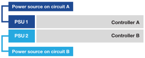

= EF50およびEF80ストレージ システムのハードウェアの電源をオンにします。
:allow-uri-read: 
:icons: font
:imagesdir: ../media/

[role="lead"]
EF50またはEF80ストレージシステムの配線が完了したら、シェルフの電源をオンにし、シェルフIDを割り当て（該当する場合）、コントローラーの電源をオンにします。

.作業を開始する前に
静電気防止処置を施します。

[[step-1-power-on-the-shelves-and-assign-shelf-ids]]
== 手順1：シェルフの電源をオンにして、シェルフIDを割り当てます

シェルフの電源を入れ、各シェルフに固有のシェルフIDを割り当ててください。

.このタスクについて
* 各シェルフに固有のシェルフIDを割り当てることで、ストレージシステム内で各シェルフが明確に区別されるようになります。
+
有効なシェルフIDは01～99です。

+
コントローラー内部に組み込まれている内部シェルフ（ストレージ）には、固定のシェルフID「00」が割り当てられます。

* シェルフIDを有効にするには、シェルフの電源を再投入する必要があります（SASシェルフの各電源装置の電源スイッチをオフにし、少なくとも10秒待ってから、電源を再びオンにします）。

.手順
. 電源コードをまず棚に接続し、電源コード保持具で固定してから、電源コードを異なる回路の電源に接続し、次に各電源装置（棚の背面）の電源スイッチをオンにして、棚に電源を投入します。
+
シェルフは電源投入時に自動的に電源がオンになり、起動します。

. 左側のエンドキャップを取り外すと、前面パネルにあるオレンジ色のシェルフIDボタンにアクセスできます。
+
image::../media/drw_shelf_id_sas_ieops-2187.svg[SASシェルフIDを変更する]

+
[cols="20%,80%"]
|===

 a| 
image::../media/icon_round_1.png[コールアウト番号1]
 a| 
シェルフエンドキャップ

 a| 
image::../media/icon_round_2.png[コールアウト番号2]
 a| 
シェルフフェースプレート

 a| 
image::../media/icon_round_3.png[[コールアウト番号3]
 a| 
シェルフ ID ボタン

 a| 
image::../media/icon_round_4.png[[コールアウト番号4]
 a| 
シェルフID番号

|===
. シェルフIDの1桁目の数字を変更します。
+
.. シェルフIDボタンを長押しし、デジタル表示の最初の数字が点滅したらボタンを離してください。
+
点滅するまでに最大15秒かかります。これにより、シェルフIDのプログラミング モードがアクティブになります。

+

NOTE: IDの点滅が15秒以上かかる場合は、シェルフIDボタンをもう一度押し続け、確実に最後まで押し込んでください。

.. シェルフIDボタンを押して離すと、0から9の範囲で希望の番号になるまで番号が進みます。
+
ボタンを押して放すまでの時間は1秒ほどです。

+
1桁目の数字は点滅したままです。

. シェルフIDの2桁目の数字を変更します。
+
.. デジタル ディスプレイの2桁目の数字が点滅するまでボタンを押し続けます。
+
点滅するまでに最大3秒かかります。

+
デジタル ディスプレイの1桁目の数字の点滅が停止します。

.. シェルフIDボタンを押して離すと、0から9の範囲で希望の番号になるまで番号が進みます。
+
2桁目の数字は点滅したままです。

. 希望の番号を確定し、2番目の数字の点滅が止まるまでシェルフIDボタンを押し続けて、プログラミングモードを終了します。
+
点滅しなくなるまでに最大3秒かかります。

+
デジタルディスプレイ上の両方の数字が点滅し始め、約5秒後にアンバー色のLEDが点灯します。これは、保留中のシェルフIDがまだ有効になっていないことを示しています。

. シェルフIDを有効にするには、シェルフの電源を少なくとも10秒間オン/オフしてください。
+
.. 各電源装置の電源スイッチをオフにしてください。
.. 10 秒待ちます。
.. 電源サイクルを完了するには、各電源装置の電源スイッチをオンにしてください。
+
電源を入れると、2色LEDが緑色に点灯します。

. 左側のエンド キャップを再度取り付けます。

[[step-2-power-on-the-controllers]]
== ステップ2：コントローラーの電源を入れる

棚の電源を入れて固有のIDを割り当てたら、コントローラーの電源を入れます。

. 各コントローラーの電源に電源ケーブルを接続し、それぞれを異なる回路の電源に接続します。
+

NOTE: サードパーティ製の電源分配ユニット（PDU）を使用している場合は、コントローラの真後ろにある電源コンセントは使用しないでください。コントローラへのアクセスが妨げられる可能性があります。

+
* 電源ケーブル *

+

+

+
** システムが起動を開始します。初回起動には最大8分かかる場合があります。
** システムシャーシのLEDが点滅し、ファンが回転し始めます。これは、コントローラの電源が入ったことを示しています。
+
起動時にファンが非常に大きな音を立てるのは正常です。

** システムシャーシ前面のデジタルディスプレイ（ベゼルの背面）が点灯しません。

. 各電源装置の固定装置を使用して電源コードを固定します。

.次の手順
ストレージシステムの電源を入れた後、link:install-complete-setup.html["ストレージシステムの完全なセットアップ"]。
