= IOM12またはIOM12Bモジュールを搭載したE2800ドライブシェルフをホットアドする
:allow-uri-read: 
:icons: font
:imagesdir: ../media/

[role="lead"]
ストレージシステムの他のコンポーネントに電源が投入されている状態で、新しいドライブシェルフを追加できます。ストレージシステム容量の設定、再設定、追加、または再割り当てを、ユーザのデータアクセスを中断することなく実行できます。

.作業を開始する前に
* この手順は複雑なため、手順を開始する前にすべての手順をよく読んでください。
+
既存のシェルフに1台以上のシェルフをホットアドする場合、手順中にシステムの整合性を維持するために、常に1つのアクティブなパスを維持する必要があります。手順は提示された順序どおりに正確に実行してください。

+
新しいシェルフを配線するには、A側（シェルフIOM A）のコントローラとシェルフ間の接続を再配線し、シェルフ間の接続を追加し、A側のパスがアクティブであることを確認し、B側（シェルフIOM B）のコントローラとシェルフ間の接続を再配線し、シェルフ間の接続を追加し、冗長性が再確立されていることを確認します。

+

NOTE: 以前にストレージシステムに設置されていたドライブシェルフを設置する場合は、この手順には追加の手順が含まれており、それを実行する必要があります。

* ドライブシェルフのホットアドが必要な手順であることを確認します。
* ストレージシステムが SANtricity のバージョンとして SAS 拡張シェルフをサポートするものを実行していること、およびサポートされる SAS シェルフの最大数を超えていないことを確認してください。
+
サポートされている SANtricity のバージョンおよびストレージシステムでサポートされる SAS 拡張シェルフの最大数については、NetApp Hardware Universe を参照してください： https://hwu.netapp.com/Controller/Index?platformTypeId=2357027["Hardware Universe"^]。

+

NOTE: SANtricity 12.10以降を実行しているEF50およびEF80ストレージシステムは、SAS拡張シェルフをサポートしています。

* ストレージシステムには、利用可能なSASポートが必要です。つまり、SAS I/Oモジュールが既にインストールされている必要があります。そうでない場合は、該当する手順に従ってSAS I/Oモジュールをインストールし、その後この手順に戻ってドライブシェルフをホットアドしてください。
+
** EF50およびEF80ストレージシステムの場合は、link:../maintenance-ef50-ef80/io-module-upgrade.html["I/Oモジュールのアップグレード"^]の手順を使用してください。
** 古いストレージシステムの場合は、「システムの保守」セクションにある、お使いのストレージシステムモデルに対応する「SAS拡張カード」の手順を使用してください。

.このタスクについて
* この手順は、E2800、E2800B、EF280、E5700、E5700B、EF570、EF300、EF600、EF300C、EF600C、E4000、EF50、またはEF80コントローラシェルフに適用されます。
+

NOTE: 古いコントローラーシェルフを配線する場合は、 https://mysupport.netapp.com/ecm/ecm_download_file/ECMLP2859057["IOM ドライブシェルフを既存の E27XX 、 E56XX 、または EF560 コントローラシェルフに追加"^]を参照してください。

* この手順は、IOM12、IOM12B、またはIOM12Cモジュールを搭載したDE212C、DE224C、またはDE460Cドライブシェルフのホットアドに適用されます。
+

NOTE: IOM12C モジュールは、SANtricity OS 11.90R3 以降でのみサポートされます。IOM12Cをインストールまたはアップグレードする前に、コントローラのファームウェアが更新されていることを確認してください。

[[step-1-prepare-to-add-the-drive-shelf]]
== 手順 1 ：ドライブシェルフを追加する準備を行います

ドライブシェルフのホットアドを準備するには、重大イベントの有無を確認し、 IOM のステータスを確認する必要があります。

.作業を開始する前に
* ストレージシステムの電源が、新しいドライブシェルフの電力要件に対応できる必要があります。ドライブシェルフの電源仕様については、を参照してください https://hwu.netapp.com/Controller/Index?platformTypeId=2357027["Hardware Universe"^]。
* 既存のストレージシステムのケーブル接続パターンが、この手順に表示されるいずれかの方式と一致している必要があります。

.手順
. SANtricity システムマネージャで、 * サポート * > * サポートセンター * > * 診断 * を選択します。
. 「サポートデータの収集」を選択します。
+
[ サポートデータの収集 ] ダイアログボックスが表示されます。

. [*Collect*]( 収集 ) をクリックします
+
ブラウザの Downloads フォルダに、 support-data.7z という名前でファイルが保存されます。データはテクニカルサポートに自動的に送信されません。

. [*Support*>*Event Log] を選択します。
+
イベントログページにイベントデータが表示されます。

. 重要なイベントをリストの先頭にソートするには、「 * 優先度 * 」列の見出しを選択します。
. 過去 2~3 週間に発生したシステムの重大イベントを確認し、最近の重大イベントが解決または対処されていることを確認します。
+

NOTE: 過去 2~3 週間以内に発生した未解決の重大イベントがある場合は、手順を停止してテクニカルサポートにお問い合わせください。問題が解決したら、手順を続行します。

. ハードウェアにIOMを接続している場合は、次の手順を実行します。それ以外の場合は、<<step2_install_drive_shelf,手順2：ドライブシェルフを設置して電源を投入します。>>
+
.. メニューの「Hardware[Controllers and components]」を選択してください。
.. IOM （ ESM ） * アイコンを選択します。
+

+
Shelf Component Settings （シェルフコンポーネントの設定）ダイアログボックスが表示され、 * IOM （ ESM ） * タブが選択されます。

.. 各 IOM / ESM に表示されるステータスが「 _optimal_」 であることを確認します。
.. [ 詳細設定を表示する *] をクリックします。
.. 次の条件を満たしていることを確認します。
+
*** 検出された ESM / IOM の数がシステムおよび各ドライブシェルフに取り付けられている ESM / IOM の数と同じである。
*** ESM / IOM のどちらの通信状況も正常である。
*** DE212C 、 DE224C 、および DE460C ドライブシェルフの場合は 12Gb/ 秒、その他のドライブトレイの場合は 6Gb/ 秒のデータ速度が必要です。

[[step-2-install-the-drive-shelf-and-apply-power]]
[[step2_install_drive_shelf]]
== 手順 2 ：ドライブシェルフを設置して電源を投入する

新しいドライブシェルフまたは以前に設置されていたドライブシェルフを設置して電源をオンにし、注意が必要な LED を確認します。

.手順
. ストレージシステムに以前に設置されていたドライブシェルフを設置する場合は、ドライブを取り外します。この手順の後半でドライブを 1 つずつ取り付ける必要があります。
+
設置するドライブシェルフの過去の設置状況が不明な場合は、ストレージシステムに以前に設置されていたものとして作業します。

. ストレージシステムコンポーネントが取り付けられているラックにドライブシェルフを設置します。
+

NOTE: 物理的な設置と電源のケーブル接続については、使用するモデルの設置手順書を参照手順してください。モデルの設置手順には、ドライブシェルフを安全に設置するために考慮する必要がある注意事項と警告が含まれています。

. 新しいドライブシェルフの電源をオンにし、ドライブシェルフの黄色の警告 LED が点灯しないことを確認します。可能であれば、障害をすべて解決してからこの手順を続行してください。

[[step-3-cable-the-drive-shelf]]
== ステップ3：ドライブシェルフにケーブルを接続する

シェルフをストレージシステムにケーブル接続するには、各コントローラが単一のシェルフまたはシェルフのスタック（該当する場合）へのA側パス（IOMA）とB側パス（IOMB）を持つように接続します。シェルフのスタックがある場合は、A側パスとB側パスを経由してシェルフ同士を接続します（シェルフ間接続）。

ケーブル配線図に示すように、コントローラーと1つ以上のシェルフを常にケーブル接続して、A側パス（IOMA）とB側パス（IOMB）用に2つのケーブル接続ができるようにしてください。

[role="tabbed-block"]
====
.EF50またはEF80用のドライブシェルフを接続する
--
この手順では、EF50またはEF80ストレージシステムへの最初のSAS拡張シェルフのホットアド方法と、2番目のシェルフをホットアドするための最初のシェルフの再配線方法について説明します。ただし、この手順は追加のシェルフを追加する場合にも適用できます。

.作業を開始する前に
ファームウェアを最新バージョンに更新しました。ファームウェアを更新するには、の手順に従います link:../upgrade-santricity/index.html["SANtricity OS のアップグレード中です"]。

.このタスクについて
* 既存のシェルフに追加のシェルフをホットアドする場合は、以下の点が適用されます。
+
** この手順では、コントローラーとシェルフ間の接続ケーブルを再配線し、コントローラーシェルフへのアクティブなパスを常に1つ維持できるようにします。
+
この手順中にアクティブなパスを1つ維持するために、A側（シェルフIOMA）のコントローラとシェルフ間の接続を再配線し、シェルフ間の接続を追加し、A側のパスがアクティブであることを確認し、B側（シェルフIOMB）のコントローラとシェルフ間の接続を再配線し、シェルフ間の接続を追加し、冗長性が再確立されていることを確認します。

** ケーブルは常にスタックの最後のシェルフから新しいシェルフの同じIOMおよびIOMポートへ移動し、その後、新しいシェルフをスタックの直前の最後のシェルフに接続します（シェルフ間接続）。

* この手順には、最大2台のシェルフをホットアドするための手順が含まれています。ただし、追加のシェルフをホットアドする場合は、手順2から始めて、追加のシェルフに手順を適用してください。
* この手順では、スロット3にSAS I/Oモジュールが1つ搭載されたコントローラについて説明します。サポートされているすべてのSAS I/Oモジュール構成については、link:https://hwu.netapp.com["NetApp Hardware Universe の略"^]を参照してください。
* 配線図では、コントローラAの接続は青色で、コントローラBの接続は赤色で示されています。点線（青と赤）は、配線作業を行うために移動する既存のケーブルを表しています。灰色のポートと線は、配線作業中にそのまま残される既存のケーブルを表しています。

.手順
. 最初のSAS拡張シェルフとなるSASシェルフを1台ホットアドするには、以下のサブステップを実行してください。それ以外の場合は、次の手順に進んでください。
+
.. コントローラAのポート3aをシェルフのIOMAポート1に接続します。
.. コントローラAのポート3bをシェルフのIOMAポート2に接続します。
.. コントローラAのポート3cをシェルフのIOMBポート3に接続します。
.. コントローラAのポート3dをシェルフのIOMBポート4に接続します。
.. コントローラBのポート3aをシェルフのIOMAポート3に接続します。
.. コントローラBのポート3bをシェルフのIOMAポート4に接続します。
.. コントローラBのポート3cをシェルフのIOMBポート1に接続します。
.. コントローラBのポート3dをシェルフのIOMBポート2に接続します。
+
シェルフのケーブル接続が完了すると、ケーブル接続は以下のようになります。

+
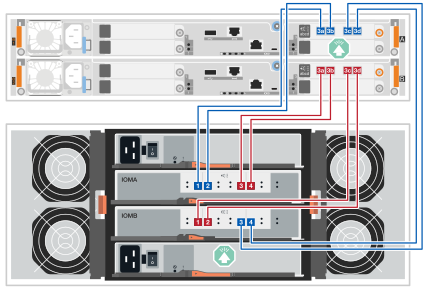

. 2台目のSAS拡張シェルフ（シェルフ2）をホットアドするには、A側のコントローラーとシェルフの接続を再配線し、A側のシェルフ間接続を追加します。手順は次のとおりです。それ以外の場合は、次のステップに進みます。
+
.. シェルフ1のIOMAポート1からケーブルを外し、シェルフ2のIOMAポート1に再接続してください。
.. シェルフ1のIOMAポート2からケーブルを取り外し、シェルフ2のIOMAポート2に再接続してください。
.. シェルフ1のIOMAポート1をシェルフ2のIOMAポート4に接続します。
.. シェルフ1のIOMAポート2をシェルフ2のIOMAポート3に接続します。
+
A側の接続ケーブルの配線が完了すると、ケーブルの状態は以下のようになります。

+
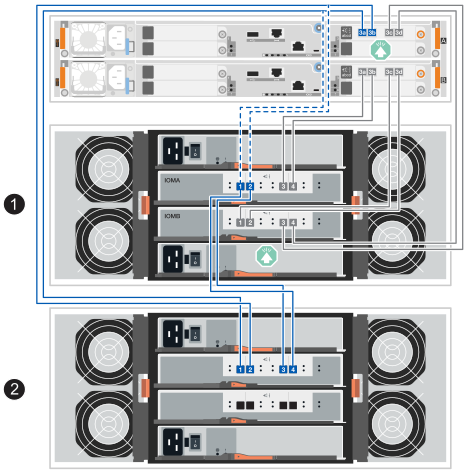

. SANtricity System Managerで、メニュー：Hardware[Controllers and components]をクリックします。
+

NOTE: 2つ目のSAS拡張シェルフを追加する場合、この手順のこの段階では、コントローラーシェルフへの有効なパスは1つしかありません。

. 必要に応じて下にスクロールして、新しいストレージシステムのドライブシェルフをすべて表示します。新しいドライブシェルフが表示されない場合は、接続問題を解決します。
. 新しいドライブシェルフの * ESM / IOM * アイコンを選択します。
+
アイコン]

+
[* Shelf Component Settings] ダイアログ・ボックスが表示されます。

. 「 * Shelf Component Settings * 」（シェルフコンポーネントの設定）ダイアログボックスで「 * ESM / IOM * 」（ * ESM / IOM * ）タブを選択します。
. 「 * 詳細オプションを表示 * 」を選択して、次のことを確認します。
+
** 最初のSAS拡張シェルフを追加する場合は、IOM/ESM AとIOM/ESM Bが表示されます。2つ目のSAS拡張シェルフを追加する場合は、IOM/ESM Aが表示されます。
** 現在のデータ速度が SAS-3 ドライブシェルフで 12Gbps になっている。
** カードの通信に問題はありません。

. 2つ目のSAS拡張シェルフを追加する場合は、次の手順に従って、B側のコントローラとシェルフの接続を再配線し、B側のシェルフ間の接続を追加します。それ以外の場合は、手順10に進みます。
+
.. シェルフ1のIOMBポート1からケーブルを外し、シェルフ2のIOMBポート1に再接続してください。
.. シェルフ1のIOMBポート2からケーブルを取り外し、シェルフ2のIOMBポート2に再接続してください。
.. シェルフ1のIOMBポート1をシェルフ2のIOMBポート3に接続します。
.. シェルフ1のIOMBポート2をシェルフ2のIOMBポート4に接続します。
+
B側接続の再配線が完了すると、配線は以下のようになります。

+
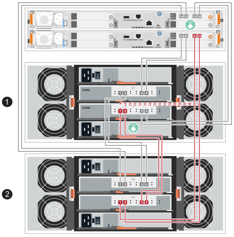

. 2つ目のSAS拡張シェルフを追加する場合、2つのシェルフの配線をやり直したら、配線は次のようになります。
+

NOTE: 2台のシェルフのスタックに3台目のシェルフをホットアドする場合、ケーブル配線は新規システム設置の「SASシェルフ接続のケーブル接続」セクションのlink:../install-hw-ef50-ef80/install-cable.html#step-3-cable-the-sas-shelf-connections["オプション2：DE460C シェルフ3台"^]の図のようになります。

+
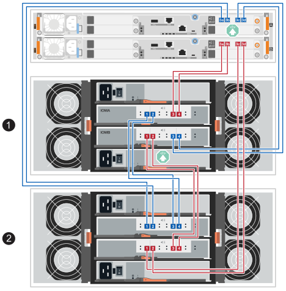

. ESM / IOM * タブが選択されていない場合は、 * Shelf Component Settings * （シェルフコンポーネント設定 * ）ダイアログボックスで * ESM / IOM * タブを選択し、 * Show more options * （詳細オプションを表示）を選択します。カード通信が *YES* であることを確認します。
+

NOTE: 「最適」ステータスは、新しいドライブシェルフに関連する冗長性の喪失エラーが解決され、ストレージシステムが安定していることを示しています。

--
.E2800またはE5700のドライブシェルフの接続
--
ドライブシェルフをコントローラ A に接続し、 IOM のステータスを確認し、ドライブシェルフをコントローラ B に接続します

.手順
. ドライブシェルフをコントローラ A に接続します
+
次の図では、追加のドライブシェルフをコントローラ A に接続する例を示しますモデル上のポートの位置を確認するには、を参照してください https://hwu.netapp.com/Controller/Index?platformTypeId=2357027["Hardware Universe"^]。

+
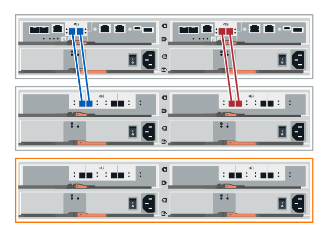

+
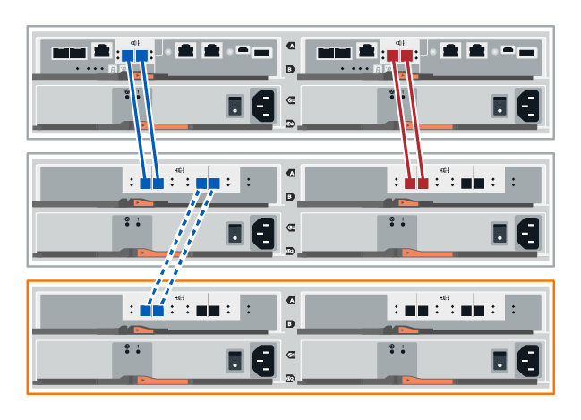

. SANtricity システムマネージャで、 * ハードウェア * をクリックします。
+

NOTE: 手順のこの時点では、コントローラシェルフへのアクティブパスは 1 つだけです。

. 必要に応じて下にスクロールして、新しいストレージシステムのドライブシェルフをすべて表示します。新しいドライブシェルフが表示されない場合は、接続問題を解決します。
. 新しいドライブシェルフの * ESM / IOM * アイコンを選択します。
+
アイコン]

+
[* Shelf Component Settings] ダイアログ・ボックスが表示されます。

. 「 * Shelf Component Settings * 」（シェルフコンポーネントの設定）ダイアログボックスで「 * ESM / IOM * 」（ * ESM / IOM * ）タブを選択します。
. 「 * 詳細オプションを表示 * 」を選択して、次のことを確認します。
+
** IOM / ESM A が表示されている。
** 現在のデータ速度が SAS-3 ドライブシェルフで 12Gbps になっている。
** カードの通信に問題はありません。

. コントローラ B からすべての拡張ケーブルを外します
. ドライブシェルフをコントローラ B に接続します
+
次の図では、追加のドライブシェルフをコントローラ B に接続する例を示しますモデル上のポートの位置を確認するには、を参照してください https://hwu.netapp.com/Controller/Index?platformTypeId=2357027["Hardware Universe"^]。

+
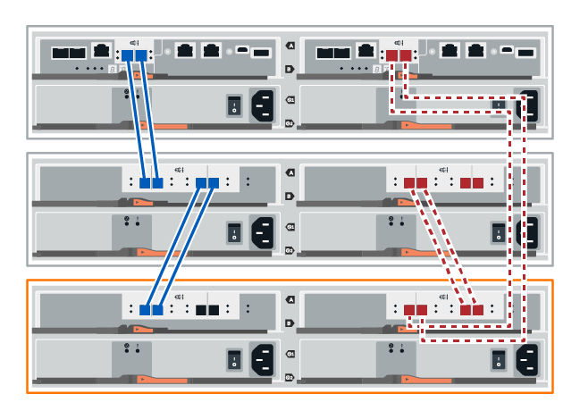

. ESM / IOM * タブが選択されていない場合は、 * Shelf Component Settings * （シェルフコンポーネント設定 * ）ダイアログボックスで * ESM / IOM * タブを選択し、 * Show more options * （詳細オプションを表示）を選択します。カード通信が *YES* であることを確認します。
+

NOTE: 「最適」ステータスは、新しいドライブシェルフに関連する冗長性の喪失エラーが解決され、ストレージシステムが安定していることを示しています。

--
.EF300またはEF600のドライブシェルフの接続
--
ドライブシェルフをコントローラ A に接続し、 IOM のステータスを確認し、ドライブシェルフをコントローラ B に接続します

.作業を開始する前に
* ファームウェアを最新バージョンに更新しました。ファームウェアを更新するには、の手順に従います link:../upgrade-santricity/index.html["SANtricity OS のアップグレード中です"]。

.手順
. スタック内の以前の最後のシェルフから A 側のコントローラケーブルを両方とも IOM12 ポート 1 と 2 から外し、新しいシェルフの IOM12 ポート 1 と 2 に接続します。
+
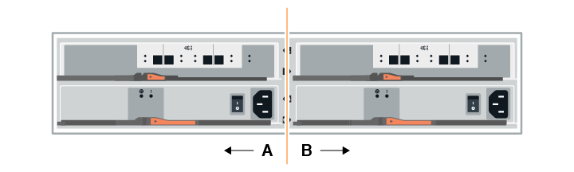

. 新しいシェルフから以前の最後のシェルフの IOM12 ポート 1 と 2 に、ケーブルを A 側の IOM12 ポート 3 と 4 に接続します。
+
次の図では、追加のドライブシェルフを前の最後のシェルフに接続する例を示します。モデル上のポートの位置を確認するには、を参照してください https://hwu.netapp.com/Controller/Index?platformTypeId=2357027["Hardware Universe"^]。

+
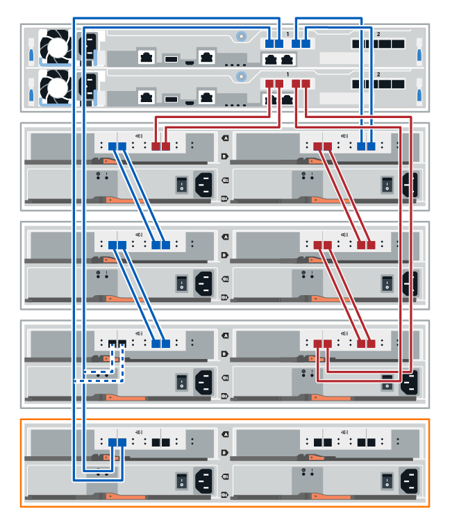

+
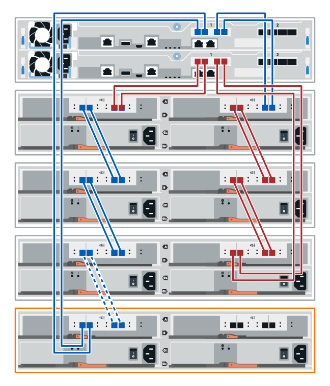

. SANtricity System Managerで、メニュー：Hardware[Controllers and components]をクリックします。
+

NOTE: 手順のこの時点では、コントローラシェルフへのアクティブパスは 1 つだけです。

. 必要に応じて下にスクロールして、新しいストレージシステムのドライブシェルフをすべて表示します。新しいドライブシェルフが表示されない場合は、接続問題を解決します。
. 新しいドライブシェルフの * ESM / IOM * アイコンを選択します。
+
アイコン]

+
[* Shelf Component Settings] ダイアログ・ボックスが表示されます。

. 「 * Shelf Component Settings * 」（シェルフコンポーネントの設定）ダイアログボックスで「 * ESM / IOM * 」（ * ESM / IOM * ）タブを選択します。
. 「 * 詳細オプションを表示 * 」を選択して、次のことを確認します。
+
** IOM / ESM A が表示されている。
** 現在のデータ速度が SAS-3 ドライブシェルフで 12Gbps になっている。
** カードの通信に問題はありません。

. スタック内の前の最後のシェルフから B 側のコントローラケーブルを両方とも IOM12 ポート 1 と 2 から外し、新しいシェルフの IOM12 ポート 1 と 2 に接続します。
. 新しいシェルフの B 側 IOM12 ポート 3 と 4 を以前の最後のシェルフの IOM12 ポート 1 と 2 にケーブルを接続します。
+
次の図では、追加のドライブシェルフを前の最後のシェルフに接続する B 側の接続例を示しています。モデル上のポートの位置を確認するには、を参照してください https://hwu.netapp.com/Controller/Index?platformTypeId=2357027["Hardware Universe"^]。

+
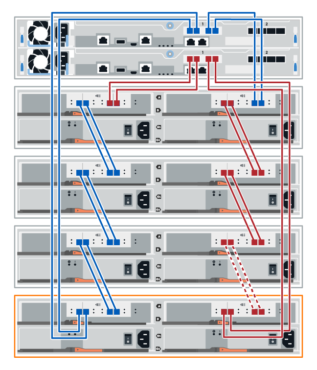

. ESM / IOM * タブが選択されていない場合は、 * Shelf Component Settings * （シェルフコンポーネント設定 * ）ダイアログボックスで * ESM / IOM * タブを選択し、 * Show more options * （詳細オプションを表示）を選択します。カード通信が *YES* であることを確認します。
+

NOTE: 「最適」ステータスは、新しいドライブシェルフに関連する冗長性の喪失エラーが解決され、ストレージシステムが安定していることを示しています。

--
.E4000のドライブシェルフの接続
--
ドライブシェルフをコントローラ A に接続し、 IOM のステータスを確認し、ドライブシェルフをコントローラ B に接続します

.手順
. ドライブシェルフをコントローラ A に接続します
+
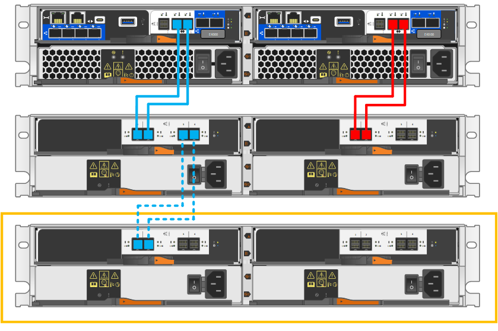

. SANtricity System Managerで、メニュー：Hardware[Controllers and components]をクリックします。
+

NOTE: 手順のこの時点では、コントローラシェルフへのアクティブパスは 1 つだけです。

. 必要に応じて下にスクロールして、新しいストレージシステムのドライブシェルフをすべて表示します。新しいドライブシェルフが表示されない場合は、接続問題を解決します。
. 新しいドライブシェルフの * ESM / IOM * アイコンを選択します。
+

+
[* Shelf Component Settings] ダイアログ・ボックスが表示されます。

. 「 * Shelf Component Settings * 」（シェルフコンポーネントの設定）ダイアログボックスで「 * ESM / IOM * 」（ * ESM / IOM * ）タブを選択します。
. 「 * 詳細オプションを表示 * 」を選択して、次のことを確認します。
+
** IOM / ESM A が表示されている。
** 現在のデータ速度が SAS-3 ドライブシェルフで 12Gbps になっている。
** カードの通信に問題はありません。

. コントローラ B からすべての拡張ケーブルを外します
. ドライブシェルフをコントローラ B に接続します
+
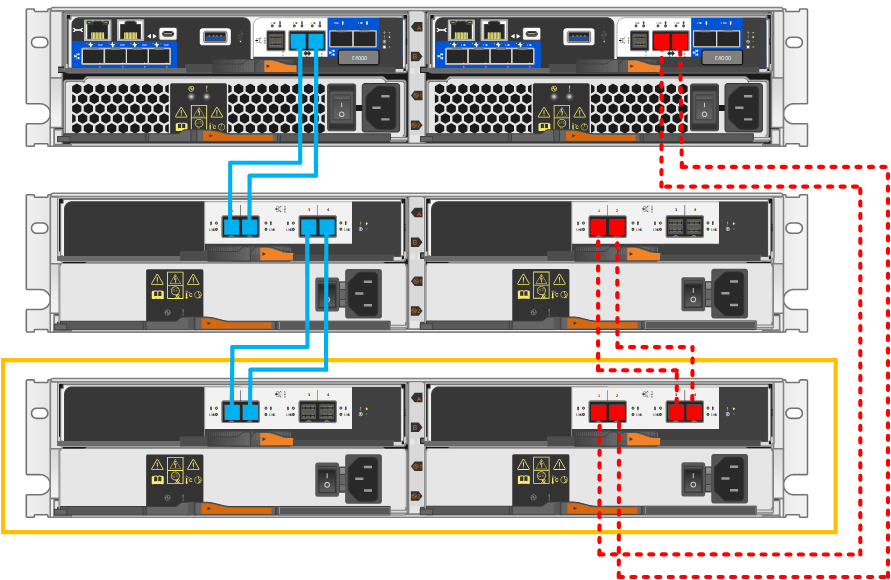

. ESM / IOM * タブが選択されていない場合は、 * Shelf Component Settings * （シェルフコンポーネント設定 * ）ダイアログボックスで * ESM / IOM * タブを選択し、 * Show more options * （詳細オプションを表示）を選択します。カード通信が *YES* であることを確認します。
+

NOTE: 「最適」ステータスは、新しいドライブシェルフに関連する冗長性の喪失エラーが解決され、ストレージシステムが安定していることを示しています。

--
====

[[step-4-assign-drive-shelf-ids]]
== ステップ4：ドライブシェルフIDを割り当てる

シェルフの電源を入れ、各シェルフに固有のシェルフIDを割り当ててください。

.このタスクについて
* 各シェルフに固有のシェルフIDを割り当てることで、ストレージシステム内で各シェルフが明確に区別されるようになります。
+
有効なシェルフIDは01～99です。

+
コントローラー内部に組み込まれている内部シェルフ（ストレージ）には、固定のシェルフID「00」が割り当てられます。

* シェルフIDを有効にするには、シェルフの電源を再投入する必要があります（SASシェルフの各電源装置の電源スイッチをオフにし、少なくとも10秒待ってから、電源を再びオンにします）。

.手順
. 左側のエンドキャップを取り外すと、前面パネルにあるオレンジ色のシェルフIDボタンにアクセスできます。
+
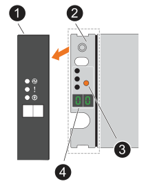

+
[cols="20%,80%"]
|===

 a| 
image::../media/icon_round_1.png[コールアウト番号1]
 a| 
シェルフエンドキャップ

 a| 
image::../media/icon_round_2.png[コールアウト番号2]
 a| 
シェルフフェースプレート

 a| 
image::../media/icon_round_3.png[[コールアウト番号3]
 a| 
シェルフ ID ボタン

 a| 
image::../media/icon_round_4.png[[コールアウト番号4]
 a| 
シェルフID番号

|===
. シェルフIDの1桁目の数字を変更します。
+
.. シェルフIDボタンを長押しし、デジタル表示の最初の数字が点滅したらボタンを離してください。
+
点滅するまでに最大15秒かかります。これにより、シェルフIDのプログラミング モードがアクティブになります。

+

NOTE: IDの点滅が15秒以上かかる場合は、シェルフIDボタンをもう一度押し続け、確実に最後まで押し込んでください。

.. シェルフIDボタンを押して離すと、0から9の範囲で希望の番号になるまで番号が進みます。
+
ボタンを押して放すまでの時間は1秒ほどです。

+
1桁目の数字は点滅したままです。

. シェルフIDの2桁目の数字を変更します。
+
.. デジタル ディスプレイの2桁目の数字が点滅するまでボタンを押し続けます。
+
点滅するまでに最大3秒かかります。

+
デジタル ディスプレイの1桁目の数字の点滅が停止します。

.. シェルフIDボタンを押して離すと、0から9の範囲で希望の番号になるまで番号が進みます。
+
2桁目の数字は点滅したままです。

. 希望の番号を確定し、2番目の数字の点滅が止まるまでシェルフIDボタンを押し続けて、プログラミングモードを終了します。
+
点滅しなくなるまでに最大3秒かかります。

+
デジタルディスプレイ上の両方の数字が点滅し始め、約5秒後にアンバー色のLEDが点灯します。これは、保留中のシェルフIDがまだ有効になっていないことを示しています。

. シェルフIDを有効にするには、シェルフの電源を少なくとも10秒間オン/オフしてください。
+
.. 各電源装置の電源スイッチをオフにしてください。
.. 10 秒待ちます。
.. 電源サイクルを完了するには、各電源装置の電源スイッチをオンにしてください。
+
電源を入れると、2色LEDが緑色に点灯します。

. 左側のエンド キャップを再度取り付けます。

[[step-5-complete-the-hot-add]]
== 手順5：ホット アドを完了する

ホットアドが完了したら、エラーがないことを確認し、新しく追加したドライブシェルフが最新のファームウェアを使用していることを確認します。

.手順
. SANtricity システムマネージャで、 * ホーム * をクリックします。
. ページ上部中央に「問題からリカバリする」というラベルのリンクが表示された場合は、そのリンクをクリックして Recovery Guru に示される問題を解決します。
. SANtricity System Managerで、メニューの「Hardware」→「Controllers and components」をクリックし、必要に応じてスクロールダウンして、新しく追加されたドライブシェルフを表示します。
. 別のストレージシステムに取り付けられていたドライブを、新たに設置したドライブシェルフに 1 本ずつ追加します。各ドライブが認識されるまで待ってから、次のドライブを挿入します。
+
ストレージ・システムがドライブを認識すると ' ハードウェア * ページのドライブ・スロットが青色の四角形で表示されます

. [ サポート * （ Support * ） ] > [ サポートセンター * （ * Support Center * ） ] > [ サポートリソース * （ * Support Resources * ） ] タブ
. [* Software and Firmware Inventory] リンクをクリックし、新しいドライブシェルフにインストールされている IOM / ESM ファームウェアとドライブファームウェアのバージョンを確認します。
+

NOTE: このリンクが見つからない場合は、ページを下にスクロールしてください。

. 必要に応じて、ドライブファームウェアをアップグレードします。
+
アップグレード機能を無効にしていないかぎり、 IOM / ESM ファームウェアは自動的に最新バージョンにアップグレードされます。

.次の手順
これでホットアド手順は完了です。通常の運用を再開することができます。
